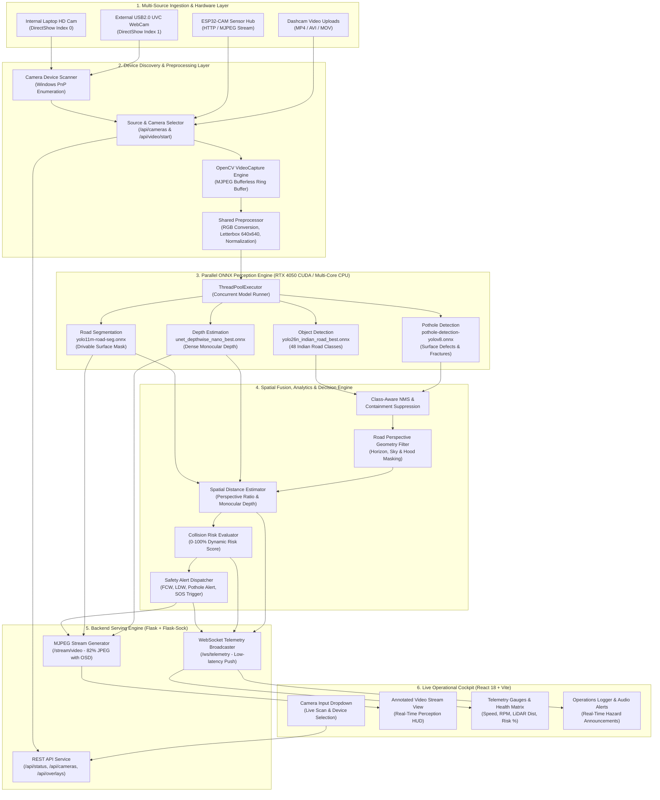

# RoadEye — Open Source Level-3 ADAS for Indian Roads

[](https://docs.ros.org/en/humble/)
[](https://en.cppreference.com/w/cpp/17)
[](https://www.python.org/)
[](https://vitejs.dev/)
[](https://onnxruntime.ai/)
[](LICENSE)
[](https://sih.gov.in/)

RoadEye is a modular, high-performance **Level-3 ADAS (Advanced Driver Assistance Systems) research prototype** engineered specifically for the chaotic, dynamic, and unstructured driving conditions of Indian roads.

Built using an optimized **Parallel ONNX Perception Stack**, selected **Autoware** localization primitives, **ESP32 DevKit V1 & ESP32-CAM** sensor hubs, multi-camera DirectShow discovery, real-time spatial decision fusion, and a modern **React + Vite cockpit dashboard**.

---

## 🏗️ System Architecture & Dataflow

The RoadEye architecture operates across 6 integrated layers, bridging physical dashcam/sensor hardware to concurrent deep learning inference and sub-second cockpit alerts:



---

## ⚡ Perception Pipeline Sequence

The diagram below details the per-frame execution lifecycle inside the parallelized `RoadEyePipeline`:

```mermaid
sequenceDiagram
    autonumber
    actor Road as Road Environment / Dashcam
    participant Ingest as VideoCapture Thread (OpenCV)
    participant Pipe as RoadEyePipeline Engine
    participant Pool as ThreadPoolExecutor
    participant ONNX as ONNX Runtime (CUDA / CPU)
    participant Decision as Decision & Risk Evaluator
    participant Backend as Flask Server & WebSocket
    participant Cockpit as React ADAS Dashboard

    Road->>Ingest: Stream Frame (640x480 @ 30 FPS)
    Ingest->>Pipe: Latest Non-Buffered Frame
    Pipe->>Pipe: Preprocess & Letterbox (RGB 640x640)
    
    rect rgb(16, 31, 51)
        Note over Pipe,ONNX: Concurrent Parallel Inference across CPU Cores / CUDA
        Pipe->>Pool: Submit 4 Inference Tasks Simultaneously
        par 1. Object Detection
            Pool->>ONNX: yolo26n_indian_road_best.onnx
            ONNX-->>Pool: 48 Class Detections (xywh, conf, cls)
        and 2. Road Segmentation
            Pool->>ONNX: yolo11m-road-seg.onnx
            ONNX-->>Pool: Drivable Surface Binary Mask (160x160 -> 640x480)
        and 3. Pothole Detection
            Pool->>ONNX: pothole-detection-yolov8.onnx
            ONNX-->>Pool: Pothole & Road Anomaly Boxes
        and 4. Depth Estimation
            Pool->>ONNX: unet_depthwise_nano_best.onnx
            ONNX-->>Pool: Monocular Depth Matrix (0.0 - 1.0)
        end
        Pool-->>Pipe: Aggregated Model Outputs
    end

    Pipe->>Decision: Filter Containment, Geometric Horizon & Road Mask
    Decision->>Decision: Estimate Obstacle Distances & Compute TTC
    Decision->>Decision: Calculate Dynamic Risk Score (0 - 100%)
    Decision-->>Pipe: Formatted InferenceResult + Safety Warnings
    
    par Live Video Stream
        Pipe->>Backend: Render HUD, Overlays & OSD -> JPEG Encode (82% Q)
        Backend->>Cockpit: Stream via HTTP Multipart (/stream/video)
    and Real-Time Telemetry
        Pipe->>Backend: Telemetry JSON Payload (Detections, Risk, Dist, FPS)
        Backend->>Cockpit: Push via WebSocket (/ws/telemetry)
    end
    
    Cockpit-->>Road: Audio Chime + Cockpit Warning Banners + Risk Meter
```



---

## 🧠 Perception Model Zoo

RoadEye runs 4 dedicated neural network models in parallel to perceive the driving corridor:

| Model Task | Neural Architecture | Weights File | Input Resolution | Classes / Outputs |
| :--- | :--- | :--- | :--- | :--- |
| **Object Detection** | YOLOv8 / YOLO26 Nano | `yolo26n_indian_road_best.onnx` | `640 × 640` | **48 Indian Traffic Classes** (Auto-rickshaws, bikes, cars, trucks, buses, pedestrians, cattle, dogs, traffic signs) |
| **Road Segmentation** | YOLO11m Segment | `yolo11m-road-seg.onnx` | `640 × 640` | Drivable road surface polygon mask & lane corridors |
| **Pothole Detection** | YOLOv8 Small | `pothole-detection-yolov8.onnx` | `640 × 640` | Potholes, road surface fractures, alligator cracks, puddles |
| **Depth Estimation** | UNet Depthwise Nano | `unet_depthwise_nano_best.onnx` | `640 × 640` | Continuous dense monocular depth map |

---

## 🚗 Core Features

- **Multi-Camera Device Discovery**: Windows PnP and DirectShow device detection allowing one-click selection between built-in laptop cameras and external USB dashcams.
- **Parallel Multi-Model Inference**: Concurrent `ThreadPoolExecutor` architecture eliminating sequential latency bottlenecks (reduced from ~2000ms+ down to real-time speeds).
- **Forward Collision Warning (FCW)**: Perspective bounding-box height and depth fusion calculating Time-To-Collision (TTC).
- **Pothole Detection & False Positive Filtering**: Geometric horizon masking, grass/vegetation HSV filtering, and obstacle shadow suppression.
- **Dynamic Collision Risk Scoring**: Real-time evaluation producing a 0–100% risk index with active color-coded visual gauge.
- **Driver Monitoring & Emergency SOS**: Fallback crash impact verification and SIM800L emergency messaging dispatch.
- **Live ADAS Cockpit Dashboard**: React 18 + Vite + Tailwind CSS dark-themed dashboard with WebSocket telemetry, MJPEG streaming, and toggleable HUD overlays.

---

## 📂 Repository Structure

```
roadeye_models-karthik/
├── backend/                             # Python ADAS Backend Engine
│   ├── models/                          # ONNX Perception Models
│   │   ├── detection/                   # yolo26n_indian_road_best.onnx
│   │   ├── segmentation/                # yolo11m-road-seg.onnx
│   │   ├── pothole/                     # pothole-detection-yolov8.onnx
│   │   └── depth/                       # unet_depthwise_nano_best.onnx
│   ├── server.py                        # Flask + Flask-Sock WebSocket Server
│   ├── pipeline.py                      # Parallel Multi-Threaded Inference Pipeline
│   ├── models_loader.py                 # ONNX Runtime CUDA/CPU Execution Provider Loader
│   ├── config.py                        # Centralized Server & Model Thresholds
│   ├── optimize_int8.py                 # ONNX INT8 Quantization & Calibration Tool
│   └── requirements.txt                 # Backend Python Dependencies
├── frontend/                            # React 18 + Vite Web Cockpit
│   ├── src/
│   │   ├── components/                  # UI Panels (VideoSourcePanel, Gauges, Map)
│   │   ├── App.jsx                      # Main Operational Cockpit Container
│   │   └── main.jsx                     # Vite Application Entrypoint
│   ├── package.json                     # Frontend npm Dependencies
│   └── vite.config.js                   # Vite Build Configuration
├── start_backend.bat                    # One-Click Backend Launcher
├── start_dashboard.bat                  # One-Click Frontend Dashboard Launcher
├── run_optimized.bat                    # Optimized Batch Launcher
├── setup_gpu.bat                        # NVIDIA RTX GPU & ONNX Runtime CUDA Configurator
└── README.md                            # Comprehensive System Documentation
```

---

## ⚡ Quickstart Guide

### 1. Prerequisites

- **OS**: Windows 10/11 or Linux / Ubuntu 22.04 LTS
- **Python**: 3.10+ (Python 3.12 recommended)
- **Node.js**: v18+ and npm
- **Hardware Acceleration (Optional but Recommended)**: NVIDIA GPU (RTX 30/40 series) with CUDA 12 support, or modern multi-core CPU.

### 2. Setup GPU Acceleration (Optional)

If running on an NVIDIA GPU (e.g. RTX 4050 / 3060):

```cmd
setup_gpu.bat
```
*Or manually:*
```bash
pip uninstall onnxruntime -y
pip install onnxruntime-gpu
```

### 3. Start Backend Server

```cmd
start_backend.bat
```
The Flask backend will launch at `http://localhost:5001`:
- **REST Status**: `http://localhost:5001/api/status`
- **Camera Discovery**: `http://localhost:5001/api/cameras`
- **Live MJPEG Stream**: `http://localhost:5001/stream/video`
- **WebSocket Telemetry**: `ws://localhost:5001/ws/telemetry`

### 4. Start Cockpit Dashboard

Open a second terminal window:

```cmd
start_dashboard.bat
```
Access the operational dashboard in your browser at: **`http://localhost:5173`**

---

## 📡 REST API & WebSocket Reference

### REST Endpoints

| Method | Endpoint | Description |
| :--- | :--- | :--- |
| `GET` | `/api/status` | Returns system health, backend mode, active camera index, and model loading status |
| `GET` | `/api/cameras` | Scans and lists all connected cameras with friendly names and DirectShow indices |
| `POST` | `/api/video/start` | Starts perception pipeline for specified source (`webcam`, `espcam`, `upload`) and `camera_index` |
| `POST` | `/api/video/stop` | Safely halts capture thread and releases video hardware |
| `POST` | `/api/video/upload` | Uploads dashcam video recording for offline analysis |
| `POST` | `/api/overlays` | Updates HUD display toggles (`showBoxes`, `showDrivable`, `showLanes`, `showDepth`) |
| `GET` | `/stream/video` | Continuous multipart MJPEG video stream with dynamic HUD and risk bar |

### WebSocket Telemetry (`/ws/telemetry`)

Pushes structured JSON telemetry packets on every processed frame:

```json
{
  "riskScore": 24.5,
  "closestDistM": 4.8,
  "detections": 3,
  "potholes": 1,
  "fps": 22.4,
  "mode": "onnx",
  "warnings": ["POTHOLE_AHEAD:Pothole:0.82"],
  "source": "webcam",
  "ts": 1731398400.12,
  "detection_items": [
    {"label": "Car", "conf": 0.89},
    {"label": "Autorickshaw", "conf": 0.76}
  ]
}
```

---

## 📄 License
This project is released under the **Apache-2.0 License**.
