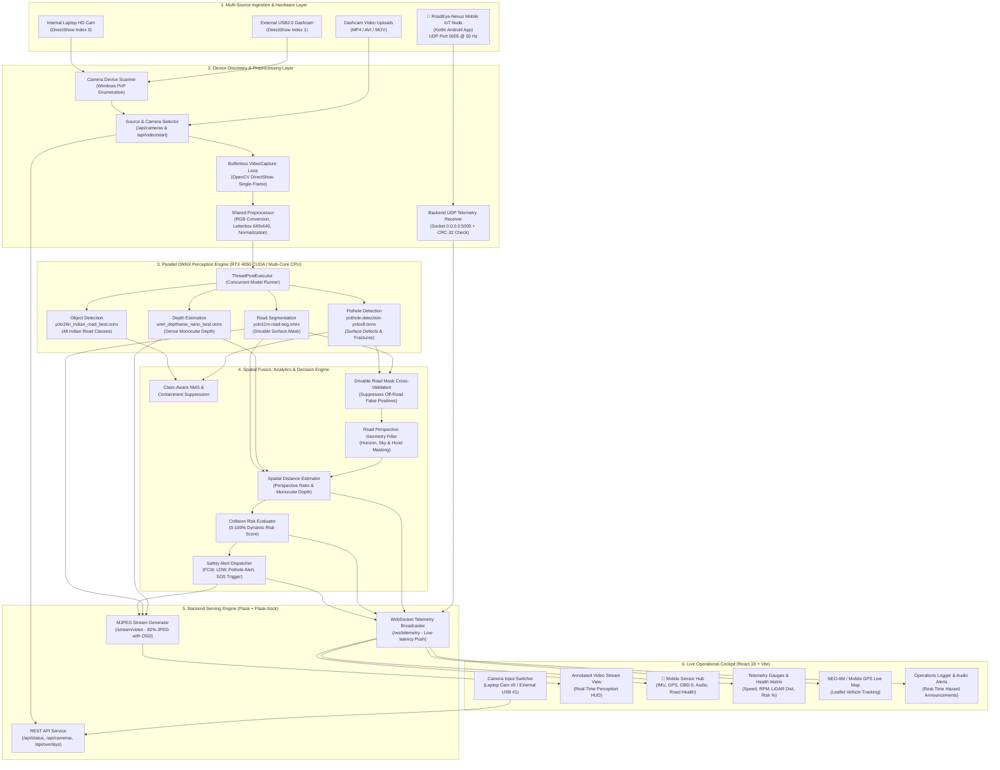

# RoadEye — Open Source Level-3 ADAS & IoT Road Intelligence System for Indian Roads

[](https://docs.ros.org/en/humble/)
[](https://en.cppreference.com/w/cpp/17)
[](https://www.python.org/)
[](https://vitejs.dev/)
[](https://github.com/MOHAMMADARFATHWR/RoadEye-Nexus)
[](https://onnxruntime.ai/)
[](LICENSE)
[](https://github.com/MOHAMMADARFATHWR/RoadEye-Nexus)

RoadEye is a modular, high-performance **Level-3 ADAS (Advanced Driver Assistance Systems) & Road Intelligence platform** engineered specifically for the chaotic, dynamic, and unstructured driving environments of Indian roads.

The system combines an optimized **Parallel ONNX Multi-Model Perception Stack**, real-time spatial decision fusion, multi-camera DirectShow discovery, a high-frequency **Mobile IoT Telemetry Node (Kotlin)**, and an interactive **React 18 + Vite Cockpit Dashboard**.

---

## 📱 Official Mobile IoT Sub-Repository: RoadEye-Nexus

The IoT sensing and vehicle kinematics layer of this project has evolved from standalone microcontrollers (ESP32) to an integrated, high-precision smartphone-based IoT node:

> 🔗 **Sub-Repository Link**: [**https://github.com/MOHAMMADARFATHWR/RoadEye-Nexus**](https://github.com/MOHAMMADARFATHWR/RoadEye-Nexus)  
> *Author / Maintainer:* [@MOHAMMADARFATHWR](https://github.com/MOHAMMADARFATHWR)  
> *Role:* Official Mobile IoT Companion Sub-Repository for the RoadEye Major Project.

### Why the Shift from ESP32 to Kotlin Mobile IoT?
1. **Rich Multi-Sensor Fusion**: Modern smartphones house enterprise-grade calibrated IMUs, dual-frequency GNSS/GPS, digital barometers, ambient photometers, acoustic microphones, and cellular connectivity without external breakout boards, messy vehicle wiring, or fragile breadboards.
2. **High-Frequency UDP Telemetry (50 Hz)**: Streams low-latency UTF-8 JSON datagrams with hardware-accelerated sensor polling (`TYPE_ACCELEROMETER`, `TYPE_GYROSCOPE`, `TYPE_ROTATION_VECTOR`, `TYPE_LINEAR_ACCELERATION`, `TYPE_PRESSURE`, `TYPE_LIGHT`, `TYPE_PROXIMITY`).
3. **OBD-II CAN-Bus Integration**: Directly couples with vehicle ELM327 / OBD-II Bluetooth adapters over standard ISO 15765-4 (CAN 11/500) to collect real-time vehicle speed, engine RPM, throttle position, coolant temperature, and engine load.
4. **On-Edge Road Intelligence**: Computes Surface Quality Index (Condition Score 0–100), Vibration RMS ($m/s^2$), and Impact Shock / Pothole collision flags on-device before transmission.
5. **CRC-32 Data Integrity**: Appends an 8-character uppercase hex CRC-32 checksum to every packet, verified in real-time by the Python backend via `zlib.crc32`.

---

## 🏗️ System Architecture & Dataflow

RoadEye operates across 6 integrated layers, bridging physical dashcams and mobile IoT telemetry to concurrent deep learning inference and sub-second cockpit alerts:



---

## ⚡ Perception Pipeline Sequence

The diagram below details the per-frame execution lifecycle inside the parallelized `RoadEyePipeline` combined with the asynchronous UDP telemetry stream:

```mermaid
sequenceDiagram
    autonumber
    actor Driver as Vehicle & Road Environment
    participant Nexus as RoadEye-Nexus (Kotlin Mobile IoT)
    participant Ingest as VideoCapture Thread (Bufferless)
    participant Pipe as RoadEyePipeline Engine
    participant Pool as ThreadPoolExecutor (ONNX Runtime)
    participant Backend as Flask Server & WebSocket
    participant Cockpit as React ADAS Cockpit

    par 50 Hz Mobile IoT Telemetry
        Driver->>Nexus: Vehicle Dynamics, GNSS, OBD-II, Acoustic Audio
        Nexus->>Backend: UDP JSON Datagram + CRC-32 (Port 5005)
        Backend->>Backend: Verify CRC-32 & Update Telemetry Cache
        Backend->>Cockpit: Push via WebSocket (/ws/telemetry)
    and 30 FPS Vision Perception
        Driver->>Ingest: Stream Camera Frame (640x480 @ 30 FPS)
        Ingest->>Pipe: Latest Non-Buffered Frame
        Pipe->>Pipe: Letterbox Preprocess (RGB 640x640)
        
        rect rgb(16, 31, 51)
            Note over Pipe,Pool: Concurrent Parallel Inference across CPU Cores / CUDA
            Pipe->>Pool: Submit 4 Inference Tasks Simultaneously
            par 1. Object Detection
                Pool->>Pool: yolo26n_indian_road_best.onnx (48 Classes)
            and 2. Road Segmentation
                Pool->>Pool: yolo11m-road-seg.onnx (Drivable Mask)
            and 3. Pothole Detection
                Pool->>Pool: pothole-detection-yolov8.onnx (Potholes & Cracks)
            and 4. Depth Estimation
                Pool->>Pool: unet_depthwise_nano_best.onnx (Monocular Depth)
            end
            Pool-->>Pipe: Aggregated Model Outputs
        end

        Pipe->>Pipe: Cross-Validate Potholes Against Drivable Surface Mask
        Pipe->>Pipe: Filter Containment, Geometric Horizon & Road Mask
        Pipe->>Pipe: Calculate Dynamic Risk Score (0 - 100%) & Safety Alerts
        
        par Live Video HUD
            Pipe->>Backend: Render HUD, Overlays & OSD -> JPEG Encode (82% Q)
            Backend->>Cockpit: Stream via HTTP Multipart (/stream/video)
        and Telemetry Sync
            Pipe->>Backend: Vision Metrics (Detections, Risk, Dist, FPS)
            Backend->>Cockpit: Push via WebSocket (/ws/telemetry)
        end
    end
    
    Cockpit-->>Driver: Audio Alerts + Pothole Ahead Banner + Hazard HUD
```



---

## 🧠 Perception Model Zoo

RoadEye executes 4 dedicated neural network models in parallel to perceive the driving corridor:

| Model Task | Neural Architecture | Weights File | Input Resolution | Classes / Outputs |
| :--- | :--- | :--- | :--- | :--- |
| **Object Detection** | YOLOv8 / YOLO26 Nano | `yolo26n_indian_road_best.onnx` | `640 × 640` | **48 Indian Traffic Classes** (Auto-rickshaws, two-wheelers, cars, trucks, buses, pedestrians, cattle, dogs, barricades) |
| **Road Segmentation** | YOLO11m Segment | `yolo11m-road-seg.onnx` | `640 × 640` | Drivable road surface polygon mask & lane corridors |
| **Pothole Detection** | YOLOv8 Small | `pothole-detection-yolov8.onnx` | `640 × 640` | Potholes, road surface fractures, alligator cracks, manholes |
| **Depth Estimation** | UNet Depthwise Nano | `unet_depthwise_nano_best.onnx` | `640 × 640` | Continuous dense monocular depth map |

---

## 📡 RoadEye-Nexus UDP JSON Telemetry Schema

The mobile application streams UTF-8 JSON datagrams to the backend server on **UDP port 5005** at up to 50 Hz:

```json
{
  "device_id": "RoadEye_Nexus_Node01",
  "seq": 1024,
  "timestamp": 1731800000.123,
  "stream_hz": 50,
  "thermal_status": "NOMINAL",
  "sensors": {
    "accel": { "x": 0.12, "y": 9.81, "z": -0.45 },
    "gyro": { "x": 0.01, "y": -0.02, "z": 0.05 },
    "mag": { "x": 25.1, "y": -12.3, "z": 45.0 },
    "gravity": { "x": 0.05, "y": 9.80, "z": 0.11 },
    "linear_accel": { "x": 0.22, "y": -0.14, "z": 0.85 },
    "rotation_vector": { "x": 0.012, "y": -0.008, "z": 0.707, "w": 0.707 },
    "orientation": { "pitch_deg": 1.5, "roll_deg": -0.8, "yaw_deg": 182.4 },
    "barometer": { "pressure_hpa": 910.25, "rel_altitude_m": 895.4 },
    "ambient_light": { "lux": 1240.5, "condition": "DAYLIGHT" },
    "proximity": { "distance_cm": 5.0, "is_near": false },
    "audio": { "active": true, "rms_dbfs": -34.2, "peak_amp": 0.125, "zcr_hz": 420.5 },
    "gps": {
      "lat": 13.050087,
      "lng": 77.714223,
      "altitude_m": 895.0,
      "speed_mps": 14.5,
      "bearing": 182.4,
      "accuracy_m": 3.8,
      "has_fix": true
    }
  },
  "device_health": {
    "battery_pct": 84,
    "battery_temp_c": 34.9,
    "charging": true,
    "wifi_rssi_dbm": -57
  },
  "road_intelligence": {
    "condition_score": 99,
    "surface_class": "SMOOTH",
    "vibration_rms": 0.079,
    "impact_detected": false
  },
  "obd2": {
    "connected": true,
    "protocol": "ISO 15765-4 (CAN 11/500)",
    "speed_kmh": 48,
    "rpm": 1850,
    "throttle_pos": 14.2,
    "coolant_temp_c": 86,
    "engine_load": 28.5
  },
  "crc32": "C5378B3D"
}
```

### CRC-32 Checksum Validation
The `crc32` field is calculated as an uppercase 8-character hex string (`zlib.crc32`) over the compact UTF-8 JSON representation with the `"crc32"` key omitted. The backend validates every packet before ingesting:

```python
import json, zlib

pkt = json.loads(data.decode("utf-8"))
received_crc = pkt.pop("crc32", None)
calc_crc = f"{zlib.crc32(json.dumps(pkt, separators=(',', ':')).encode('utf-8')) & 0xFFFFFFFF:08X}"
is_valid = (received_crc == calc_crc)
```

---

## 🚗 Core System Features

- **Mobile IoT Telemetry Integration**: Native connection to [RoadEye-Nexus](https://github.com/MOHAMMADARFATHWR/RoadEye-Nexus) over UDP port 5005 with live mobile device telemetry display.
- **Physical Webcam Device Switcher**: Dynamic discovery and seamless switching between Built-in Laptop Cameras (`Index 0`) and External USB Dashcams (`Index 1`) via Windows DirectShow enumeration.
- **Zero-Latency Video Pipeline**: Dedicated single-slot reader thread decoupling frame ingestion from inference to eliminate camera buffering delay.
- **Parallel Multi-Model Inference**: Concurrent `ThreadPoolExecutor` architecture running 4 deep neural networks simultaneously.
- **False Positive Pothole Filtering**: Cross-references detected potholes against drivable road segmentation masks, eliminating false alarms on highway dividers, vegetation, and walls.
- **Calibrated Lane Guidance Path**: Perspective road trajectory overlay dynamically calibrated to vehicle wheel track width.
- **Vehicle OBD-II Telemetry**: Live engine RPM, vehicle speed, throttle position, and coolant temperature gauges.
- **Live ADAS Cockpit Dashboard**: React 18 + Vite + Tailwind CSS dark cockpit with WebSocket push telemetry, interactive GPS vehicle tracking, and toggleable HUD overlays.

---

## 📂 Repository Structure

```
roadeye_models-karthik/
├── backend/                             # Python ADAS Backend Engine
│   ├── models/                          # ONNX Perception Models
│   │   ├── detection/                   # yolo26n_indian_road_best.onnx
│   │   ├── segmentation/                # yolo11m-road-seg.onnx
│   │   ├── pothole/                     # pothole-detection-yolov8.onnx
│   │   └── depth/                       # unet_depthwise_nano_best.onnx
│   ├── server.py                        # Flask + Flask-Sock Server & UDP Receiver (5005)
│   ├── pipeline.py                      # Parallel Multi-Threaded Inference Pipeline
│   ├── models_loader.py                 # ONNX Runtime CUDA/CPU Execution Provider Loader
│   ├── config.py                        # Centralized Server & Model Thresholds
│   ├── roadeye_receiver.py              # Standalone Desktop Telemetry Receiver & GUI
│   ├── optimize_int8.py                 # ONNX INT8 Quantization & Calibration Tool
│   └── requirements.txt                 # Backend Python Dependencies
├── frontend/                            # React 18 + Vite Web Cockpit
│   ├── src/
│   │   ├── components/
│   │   │   ├── MobileSensorHub.jsx      # Mobile IoT Telemetry & Road Intelligence HUD
│   │   │   ├── VideoSourcePanel.jsx     # Camera Device Selector (Laptop / USB)
│   │   │   ├── SensorHealth.jsx         # Sensor & System Health Matrix
│   │   │   ├── GpsMap.jsx               # Live GPS Vehicle Location Tracker
│   │   │   └── ...                      # ADAS Gauges, Telemetry Charts, Audio Alerts
│   │   ├── App.jsx                      # Main Operational Cockpit Container
│   │   └── main.jsx                     # Vite Application Entrypoint
│   ├── package.json                     # Frontend npm Dependencies
│   └── vite.config.js                   # Vite Build Configuration
├── start_backend.bat                    # One-Click Backend Launcher
├── start_dashboard.bat                  # One-Click Frontend Dashboard Launcher
├── run_optimized.bat                    # Optimized Batch Launcher
├── setup_gpu.bat                        # NVIDIA RTX GPU & ONNX Runtime CUDA Configurator
└── README.md                            # Comprehensive System Documentation
```

### Companion Sub-Repository
- [**RoadEye-Nexus (Mobile IoT Companion)**](https://github.com/MOHAMMADARFATHWR/RoadEye-Nexus): Kotlin Android application for smartphone-based road sensing, vehicle kinematics, and OBD-II telemetry streaming.

---

## ⚡ Quickstart Guide

### 1. Prerequisites

- **OS**: Windows 10/11 or Linux / Ubuntu 22.04 LTS
- **Python**: 3.10+ (Python 3.12 recommended)
- **Node.js**: v18+ and npm
- **Android Device (for Mobile IoT)**: Android 10+ running the [RoadEye-Nexus](https://github.com/MOHAMMADARFATHWR/RoadEye-Nexus) app on the same local Wi-Fi network.
- **Hardware Acceleration (Optional)**: NVIDIA GPU (RTX 30/40 series) with CUDA 12, or modern multi-core CPU.

### 2. Setup GPU Acceleration (Optional)

If running on an NVIDIA GPU (e.g. RTX 4050 / 3060):

```cmd
setup_gpu.bat
```
*Or manually:*
```bash
pip uninstall onnxruntime -y
pip install onnxruntime-gpu
```

### 3. Start Backend Server & UDP Telemetry Receiver

```cmd
start_backend.bat
```
The Flask backend will launch at `http://localhost:5001` and automatically start listening for mobile telemetry on **UDP port 5005**:
- **REST Status**: `http://localhost:5001/api/status`
- **Camera Discovery**: `http://localhost:5001/api/cameras`
- **Live MJPEG Stream**: `http://localhost:5001/stream/video`
- **WebSocket Telemetry**: `ws://localhost:5001/ws/telemetry`
- **UDP IoT Ingestion**: `0.0.0.0:5005` (UTF-8 JSON with CRC-32)

### 4. Connect RoadEye-Nexus Mobile App

1. Clone and open [RoadEye-Nexus](https://github.com/MOHAMMADARFATHWR/RoadEye-Nexus) in Android Studio.
2. Build and install the APK onto your Android smartphone.
3. In the app settings, set the Target IP to your laptop/workstation IP and Port to `5005`.
4. Tap **Start Streaming**. The dashboard **Sensor Hub** tab will immediately show `LIVE UDP STREAM` with 50 Hz live metrics.

### 5. Start Cockpit Dashboard

Open a second terminal window:

```cmd
start_dashboard.bat
```
Access the operational dashboard in your browser at: **`http://localhost:5173`**

---

## 📡 REST API & WebSocket Reference

### REST Endpoints

| Method | Endpoint | Description |
| :--- | :--- | :--- |
| `GET` | `/api/status` | Returns system health, backend mode, active camera index, and model loading status |
| `GET` | `/api/cameras` | Scans and lists all connected cameras with friendly names and DirectShow indices |
| `POST` | `/api/video/start` | Starts perception pipeline for specified source (`webcam`, `espcam`, `upload`) and `camera_index` |
| `POST` | `/api/video/stop` | Safely halts capture thread and releases video hardware |
| `POST` | `/api/video/upload` | Uploads dashcam video recording for offline analysis |
| `POST` | `/api/overlays` | Updates HUD display toggles (`showBoxes`, `showDrivable`, `showLanes`, `showDepth`) |
| `GET` | `/stream/video` | Continuous multipart MJPEG video stream with dynamic HUD and risk bar |

### WebSocket Telemetry (`/ws/telemetry`)

Pushes structured JSON telemetry packets combining vision AI detections with live mobile IoT sensor data:

```json
{
  "riskScore": 24.5,
  "closestDistM": 4.8,
  "detections": 3,
  "potholes": 1,
  "fps": 22.4,
  "mode": "onnx",
  "warnings": ["POTHOLE_AHEAD:Pothole:0.82"],
  "source": "webcam",
  "camera_index": 1,
  "mobile_iot": {
    "device_id": "RoadEye_Nexus_Node01",
    "seq": 1024,
    "speed_kmh": 48,
    "rpm": 1850,
    "road_condition": 99,
    "vibration_rms": 0.079,
    "crc_match": true
  }
}
```

---

## 📄 License & Attribution
- RoadEye Major Project is licensed under the **Apache-2.0 License**.
- Companion Mobile IoT Sub-Repository: [**RoadEye-Nexus**](https://github.com/MOHAMMADARFATHWR/RoadEye-Nexus) by [@MOHAMMADARFATHWR](https://github.com/MOHAMMADARFATHWR).
