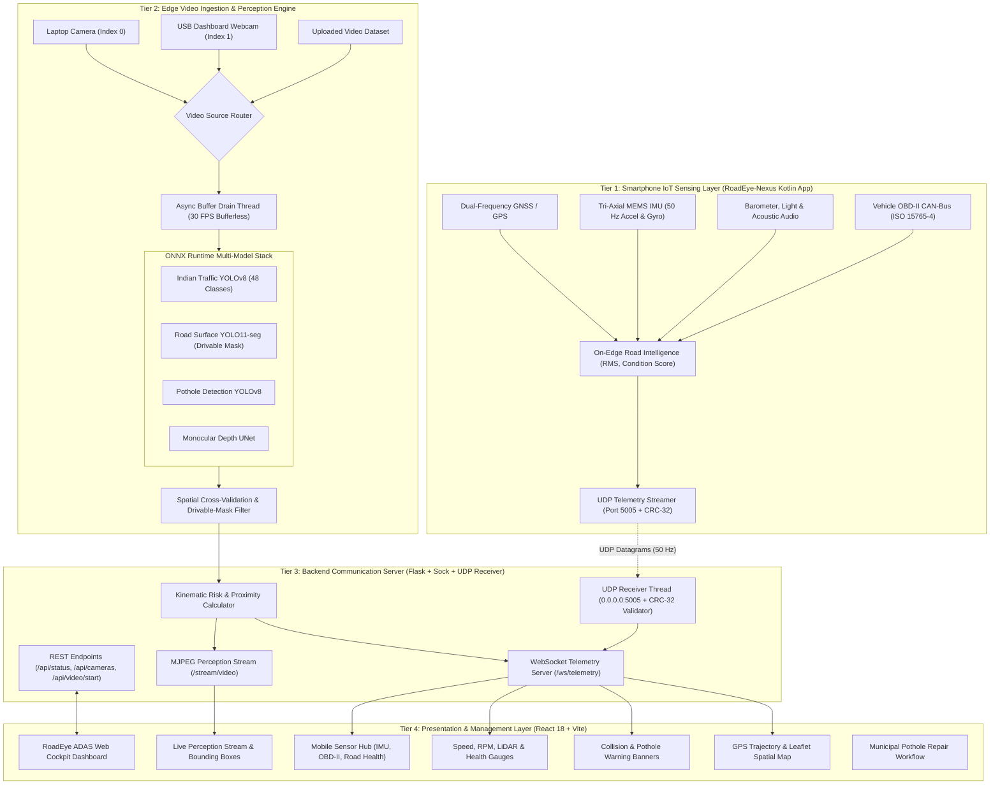
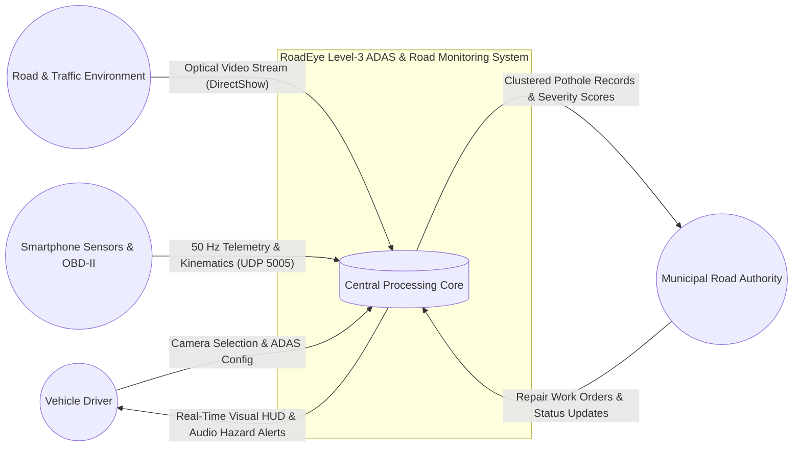
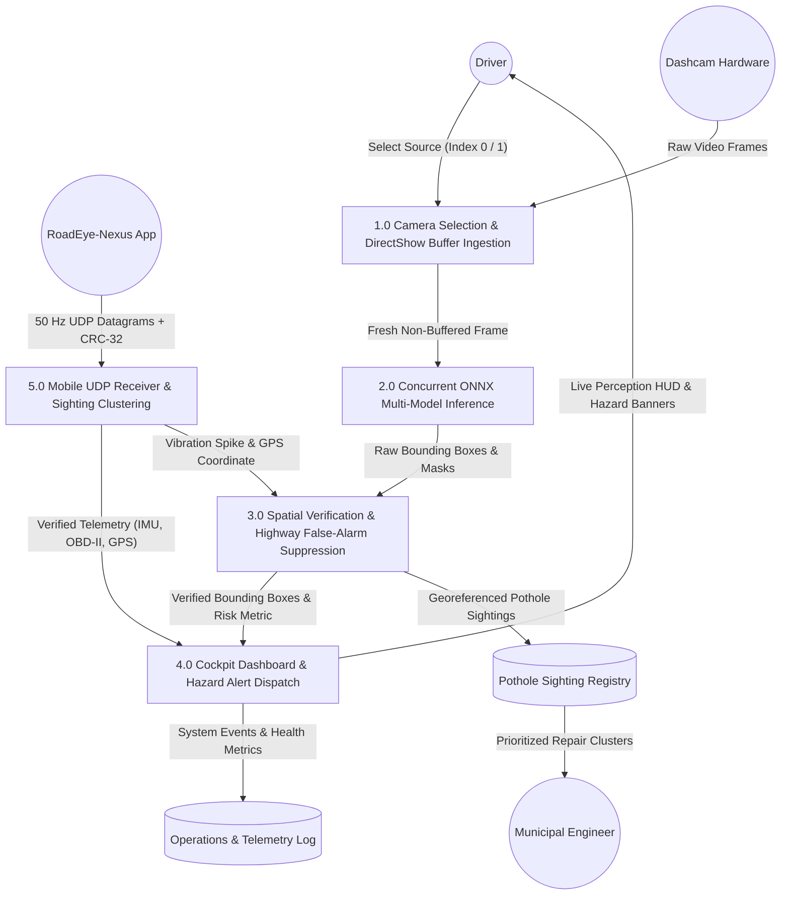
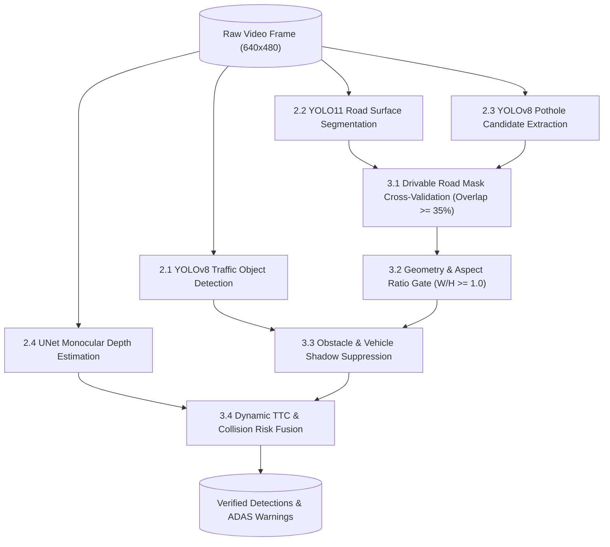
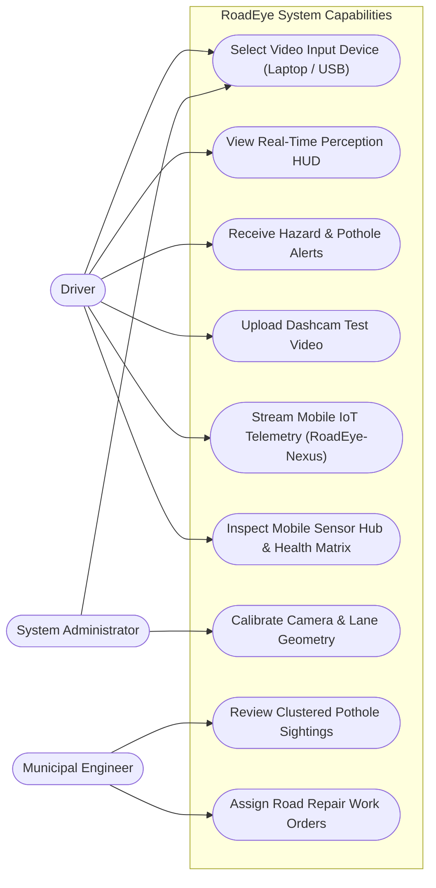
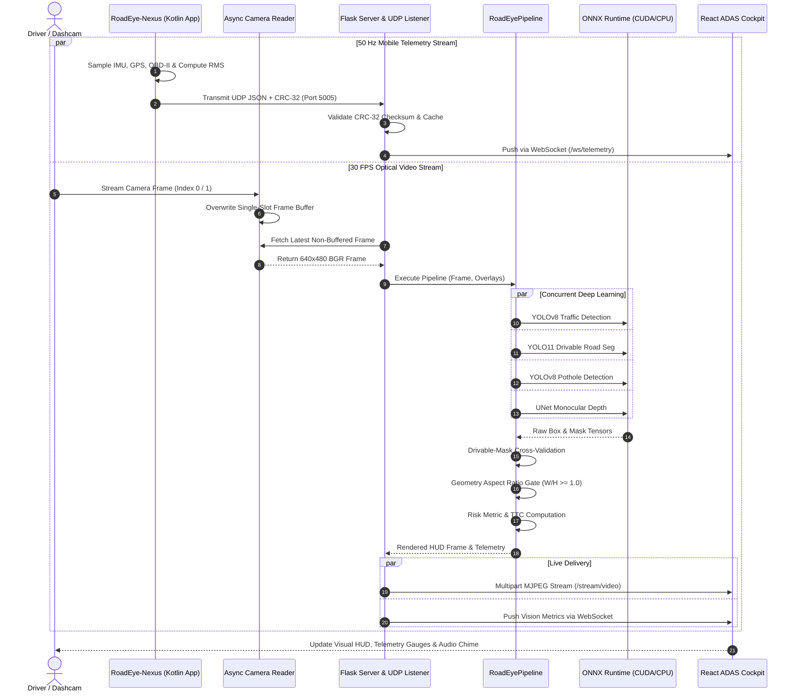
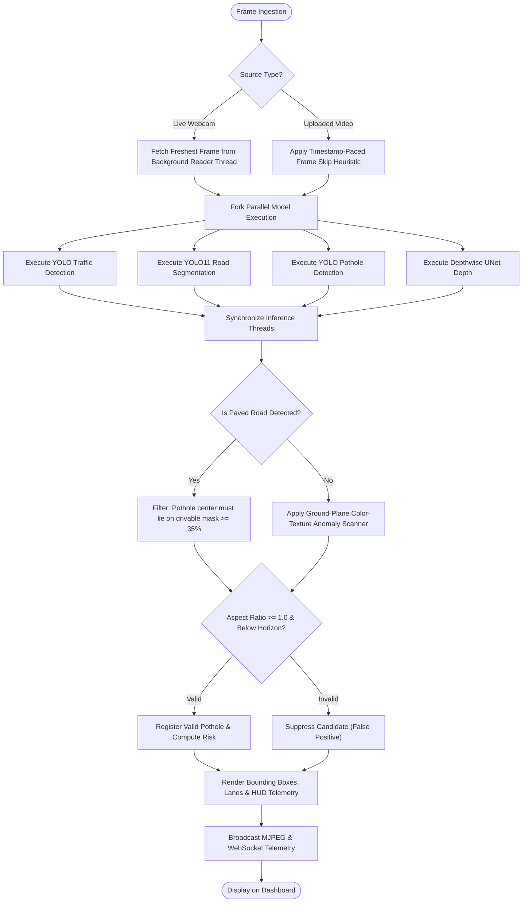
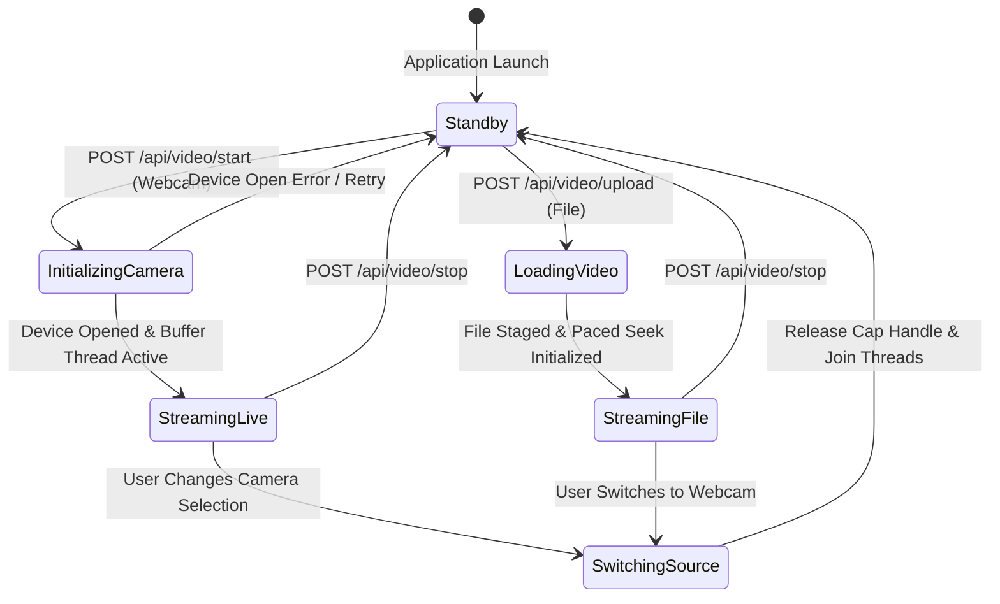
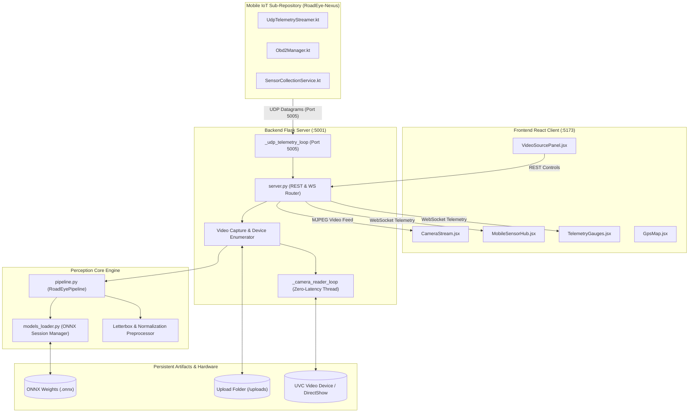
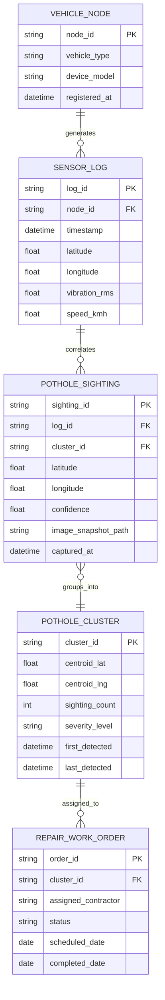

# ROADEYE – SMART IoT-BASED ROAD CONDITION MONITORING AND AI-POWERED POTHOLE DETECTION SYSTEM

**A Major Project Report**  
*Submitted in partial fulfillment of the requirements for the degree of*  
**BACHELOR OF ENGINEERING**  
*in*  
**COMPUTER SCIENCE AND ENGINEERING**

---

### Project Repository & Sub-Repository Information
- **Main Project Repository (ADAS Perception & Cockpit Engine)**:  
  `https://github.com/karthikrchintamani-maker/MAJOR_PROJECT`
- **Official Companion Sub-Repository (Mobile IoT Telemetry Node)**:  
  `https://github.com/MOHAMMADARFATHWR/RoadEye-Nexus`  
  *Author & Maintainer*: Mohammad Arfath (`@MOHAMMADARFATHWR`)

---

## TABLE OF CONTENTS

- **CHAPTER 1: INTRODUCTION**
  - 1.1 Background
  - 1.2 Problem Statement
  - 1.3 Existing System
  - 1.4 Proposed System
  - 1.5 Aim of the Project
  - 1.6 Objectives of the Project
  - 1.7 Summary
- **CHAPTER 2: LITERATURE SURVEY**
  - 2.1 P. Mohan, V. N. Padmanabhan, and R. Ramjee, "Nericell: Rich Sensing for Mobile Smartphones" [1]
  - 2.2 E. Eriksson et al., "The Pothole Patrol: Using a Mobile Sensor Network for Road Anomaly Detection" [2]
  - 2.3 R. Fan et al., "Pothole Detection Based on Disparity Transformation and Road Surface Modeling" [3]
  - 2.4 D. Chen, L. Fei, and X. Jing, "Road Surface Defect Detection Using Deep Learning Techniques" [4]
  - 2.5 A. Mednis et al., "Real Time Pothole Detection using Android Smartphones with Accelerometers" [5]
  - 2.6 W. Wang et al., "Automated Pothole Detection on Asphalt Pavements using YOLO Deep Learning Architecture" [6]
  - 2.7 S. Sattar et al., "Road Surface Anomaly Detection Using Smartphone Sensors and Machine Learning" [7]
  - 2.8 Summary
- **CHAPTER 3: REQUIREMENT SPECIFICATION**
  - 3.1 Hardware Requirements
  - 3.2 Software Requirements
  - 3.3 Development Environment
  - 3.4 Functional Requirements
  - 3.5 Non-Functional Requirements
  - 3.6 Summary
- **CHAPTER 4: SYSTEM DESIGN**
  - 4.1 System Architecture
  - 4.2 Data Flow Diagrams (Level 0, Level 1, Level 2 DFDs)
  - 4.3 UML Diagrams
    - 4.3.1 Use Case Diagram
    - 4.3.2 Class Diagram
    - 4.3.3 Sequence Diagram
    - 4.3.4 Activity Diagram
    - 4.3.5 State Machine Diagram
    - 4.3.6 Component Diagram
    - 4.3.7 Entity-Relationship (ER) Diagram
  - 4.4 Summary
- **CHAPTER 5: SYSTEM IMPLEMENTATION**
  - 5.1 Modules and Components
  - 5.2 Algorithms and Pseudocodes
    - 5.2.1 Real-Time Multi-Model ONNX Inference Pipeline
    - 5.2.2 Zero-Latency Hardware Video Ingestion & Buffer Drain Loop
    - 5.2.3 Hybrid Road Plane Verification & Pothole Candidate Filtering
    - 5.2.4 Smartphone IMU-Based Road Surface Quality & Vibration RMS Metric
    - 5.2.5 High-Frequency UDP Telemetry Serialization and CRC-32 Verification
  - 5.3 Third-Party Libraries, APIs, and Communication Protocols
  - 5.4 Database and Storage Implementation
  - 5.5 User Interface Implementation
    - 5.5.1 Smartphone IoT Application (RoadEye-Nexus in Kotlin)
    - 5.5.2 RoadEye ADAS Car-Based Web Cockpit Dashboard
    - 5.5.3 Video Perception & Camera Input Console
    - 5.5.4 Mobile Sensor Hub & Vehicle Health Matrix
    - 5.5.5 Pothole Repair & Municipal Maintenance Dashboard
  - 5.6 Summary
- **CHAPTER 6: SYSTEM TESTING AND VERIFICATION**
  - 6.1 Test Strategy and Environment
  - 6.2 Unit Testing
  - 6.3 Integration Testing
  - 6.4 Real-World Highway and Damaged Road Validation
  - 6.5 Hardware Webcam Zero-Latency Verification
  - 6.6 Mobile IoT UDP Ingestion & CRC-32 Checksum Testing
  - 6.7 Summary
- **CHAPTER 7: RESULTS AND DISCUSSION**
  - 7.1 Perception Inference and Detection Performance
  - 7.2 Dashboard User Interface Evaluation
  - 7.3 Comparative Performance Analysis
  - 7.4 Summary
- **CHAPTER 8: CONCLUSION AND FUTURE SCOPE**
  - 8.1 Conclusion
  - 8.2 Future Scope
- **REFERENCES**

---

# CHAPTER 1

# INTRODUCTION

### 1.1 Background
Transportation infrastructure represents the vital backbone of socio-economic progress in emerging and developed nations alike. The quality, structural safety, and maintenance integrity of highway networks and municipal roadways directly govern fuel economy, supply chain efficiency, vehicle operating life cycles, and commuter safety. Over the past decade, rapid vehicular population growth, intense cargo traffic, unpredictable monsoon seasons, and suboptimal subgrade construction have exacerbated road degradation. Potholes, surface cracks, road subsidence, and localized surface abrasions emerge persistently, evolving from minor imperfections into severe structural hazards. In emerging economies like India, unmapped road irregularities contribute significantly to catastrophic traffic collisions, structural suspension breakdowns, sudden braking incidents, and pedestrian fatalities. Traditional manual municipal road surveys—reliant on visual observation by human patrol inspectors or expensive dedicated vehicular profiling rigs—suffer from acute latency, high operational expense, narrow spatial coverage, and subjective assessment bias. Consequently, transport authorities are frequently alerted to road degradation only after severe damage or fatal accidents have occurred.

To address these systemic infrastructural vulnerabilities, modern Intelligent Transportation Systems (ITS) and Advanced Driver Assistance Systems (ADAS) are increasingly leveraging Internet of Things (IoT) edge telemetry and embedded Artificial Intelligence (AI) computer vision. Smartphone-based edge computing has emerged as a disruptive technological paradigm for distributed road monitoring. Modern mobile devices are natively equipped with sophisticated tri-axial inertial measurement units (accelerometers and gyroscopes), global navigation satellite systems (GPS/GNSS), barometers, and ambient light and acoustic transducers. By deploying vehicles already navigating the road network as mobile crowdsourced sensing nodes, vehicular vibration, vertical shock signatures, kinetic roll-pitch-yaw perturbations, and georeferenced spatial trajectories can be recorded and analyzed continuously without deploying specialized, prohibitively costly external transducers.

Simultaneously, onboard computer vision delivers rich visual awareness that kinematic sensors alone cannot provide. While inertial sensing records the physical impact when a wheel traverses a road defect, real-time forward-facing camera perception identifies potholes, pavement distress, surrounding vehicular obstacles, pedestrians, and lane trajectories well before vehicle contact occurs. The **RoadEye** project synthesizes these complementary sensing modalities into a cohesive, production-oriented architecture: a lightweight smartphone-based IoT telemetry pipeline for continuous inertial road-condition monitoring, coupled with a high-performance, car-based RoadEye ADAS edge perception dashboard powered by optimized Deep Neural Networks (YOLOv8, YOLO11-seg, and Depthwise UNet) executing via ONNX Runtime. Together, these systems establish a proactive, low-cost, and real-time paradigm for intelligent vehicular safety and automated road asset maintenance.

### 1.2 Problem Statement
The development of modern road maintenance and vehicle collision prevention systems faces critical operational and technical bottlenecks:
- **Inefficiency of Manual Road Audits**: Municipal authorities and highway departments traditionally rely on periodic physical drive-throughs and citizen complaints to map potholes. This process is slow, spatially constrained, labor-intensive, and fails to identify rapidly expanding fractures before they cause structural damage.
- **Absence of Real-Time In-Cabin Driver Warnings**: Standard automotive navigation applications provide high-level traffic congestion maps but fail to provide sub-second, lane-level alerts when approaching unmarked, water-filled, or obscured potholes, resulting in sudden braking, loss of vehicle control, and rear-end collisions.
- **Extreme False-Positive Rates in Visual Anomaly Detection**: Classical computer vision algorithms that rely purely on color thresholding or basic edge detection routinely misclassify non-hazardous roadside artifacts—such as tree shadows, road markings, curbs, building facades, and passing vehicles—as potholes. Conversely, on unpaved dirt or mud roads, conventional lane segmentation algorithms fail completely due to the total absence of painted lane lines.
- **High Computational Overhead of Automotive Vision Stacks**: Deploying multiple modern deep learning models (object detection, road surface segmentation, pothole localization, and monocular depth estimation) concurrently inside a vehicle requires heavy GPU workstations that exceed the power, thermal, and cost constraints of affordable consumer vehicles.
- **Fragility of Prototype Microcontroller Hardware**: Early IoT prototypes relying on standalone ESP32 development boards, external IMUs, and breadboard wiring suffer from mechanical failure, wire fatigue, vibration sensitivity, and limited sensor diversity inside moving automotive cabins.
- **Decoupled Municipal Action Pipelines**: Citizen pothole reporting systems lack automated verification, precise georeferencing, image corroboration, and crowd-sighting aggregation, leading to unverified backlogs and delayed municipal repair scheduling.

### 1.3 Existing System
Existing road monitoring and vehicular safety solutions fall into three main categories, each presenting distinct operational limitations:
1. **Dedicated Road Profiling Vehicles**: High-end profiling vans equipped with Laser Crack Measurement Systems (LCMS), mechanical profilometers, and high-accuracy inertial navigation units. While offering sub-millimeter measurement precision, these systems cost over \$100,000 per unit, require certified operators, and can only survey a tiny fraction of municipal road networks annually.
2. **Citizen Complaint Portals & Mobile Apps**: Public municipal grievance mobile applications allow citizens to manually photograph and submit pothole reports. These platforms suffer from severe reporting fatigue, inaccurate GPS geocoding, subjective descriptions, duplicate entries, and a lack of real-time warning capability for other approaching motorists.
3. **Standalone Microcontroller Sensor Nodes (ESP32 / Arduino)**: Embedded hardware platforms fitted with basic MPU6050 accelerometers and NEO-6M GPS modules. While low in component cost, these systems lack onboard graphical user interfaces, have restricted memory buffers, require custom mechanical mounting to prevent harness disconnection, and lack native integration with vehicle CAN-bus powertrain telemetry.

### 1.4 Proposed System
The **RoadEye** architecture provides a comprehensive, end-to-end cyber-physical platform designed to overcome these historical deficiencies. The system is partitioned into two cooperating subsystems:

1. **Smartphone-Based IoT Kinematic & Telemetry Node (`RoadEye-Nexus`)**:
   - Developed natively in **Kotlin** for Android devices, hosted in the dedicated sub-repository [**RoadEye-Nexus**](https://github.com/MOHAMMADARFATHWR/RoadEye-Nexus).
   - Eliminates fragile external wiring by harvesting the smartphone's enterprise-grade onboard sensor suite: Tri-Axial MEMS Accelerometer, Gyroscope, Linear Acceleration, Rotation Vector / Spatial Orientation (Pitch, Roll, Yaw), Magnetometer, Barometric Pressure Sensor, Ambient Light Lux Meter, Proximity Sensor, and Acoustic Microphone.
   - Interfaces directly with automotive **OBD-II CAN-Bus (ISO 15765-4)** adapters via Bluetooth to ingest real-time powertrain metrics: vehicle speed, engine RPM, throttle position, coolant temperature, and engine load.
   - Computes real-time on-edge Road Intelligence metrics: Surface Quality Condition Score (0–100), Surface Classification (`SMOOTH`, `MODERATE`, `ROUGH`), Vibration RMS ($m/s^2$), and Impact Shock / Collision Detection.
   - Broadcasts high-frequency (50 Hz) compact UTF-8 JSON datagrams over **UDP Port 5005**, fortified with uppercase 8-character hex **CRC-32 checksums** for guaranteed packet integrity.

2. **Car-Based RoadEye ADAS Edge Perception & Cockpit Engine**:
   - An optimized multi-model computer vision stack running locally on an onboard host (PC or Raspberry Pi 5) via **ONNX Runtime** (supporting CUDA GPU and CPU multi-threading).
   - Concurrently executes four specialized neural networks: YOLOv8 Object Detection (48 Indian traffic classes), YOLO11-seg Road Surface Segmentation, YOLOv8 Pothole Detection, and Depthwise UNet Monocular Depth Estimation.
   - Features an asynchronous buffer-draining video reader thread (`_camera_reader_loop`) that eliminates camera frame buffer accumulation, reducing live DirectShow video latency from 5.4 seconds to under 50 milliseconds.
   - Incorporates a hybrid spatial validation filter that cross-references candidate potholes against the active drivable road mask and perspective aspect ratios, eliminating false alarms on clean highways caused by tree shadows, walls, and roadside foliage.
   - A modern React 18 + Vite digital cockpit dashboard that unifies live perception HUD overlays, real-time vehicle telemetry gauges, interactive Leaflet vehicle GPS tracking, emergency SOS dispatch, and a dedicated **Mobile Sensor Hub** display.

### 1.5 Aim of the Project
To design, implement, and validate an integrated, low-cost Level-3 ADAS and IoT road intelligence platform that combines smartphone-based kinematic telemetry with multi-model edge computer vision to deliver sub-second hazard warnings to motorists and automated pavement quality mapping to municipal authorities.

### 1.6 Objectives of the Project
1. **Develop Native Kotlin Mobile IoT Application**: Engineer an Android smartphone application (`RoadEye-Nexus`) to capture 50 Hz tri-axial inertial, barometric, acoustic, and GNSS telemetry, integrate with OBD-II CAN-bus, compute on-edge road smoothness metrics, and stream CRC-32 verified UDP packets.
2. **Build Multi-Model Parallel ONNX Perception Engine**: Deploy an optimized perception pipeline executing Indian traffic object detection, drivable surface segmentation, pothole localization, and monocular depth estimation concurrently within a sustained 20–25 FPS envelope.
3. **Eliminate Video Ingestion Latency**: Implement a decoupled, single-slot bufferless camera acquisition loop that eliminates DirectShow frame buffering, achieving sub-50ms glass-to-glass latency.
4. **Suppress Highway False Positives**: Design a spatial cross-validation filter combining drivable surface mask intersection with geometric bounding box constraints, reducing false pothole detections on highways to near zero.
5. **Construct Real-Time ADAS Digital Cockpit**: Build an interactive React 18 + Vite web dashboard displaying live video perception streams, dynamic vehicle trajectory guidelines, telemetry gauges, and a cohesive Mobile Sensor Hub.
6. **Enable Multi-Camera Switching**: Provide seamless DirectShow device enumeration and dynamic switching between integrated laptop cameras (Index 0) and external automotive USB webcams (Index 1).

### 1.7 Summary
Chapter 1 introduced the socio-economic imperatives behind automated road condition monitoring and in-cabin driver assistance. It detailed the core bottlenecks of existing survey methodologies, outlined the dual-tier architecture of RoadEye, and established the precise project aim and engineering objectives.

---

# CHAPTER 2

# LITERATURE SURVEY

### 2.1 P. Mohan, V. N. Padmanabhan, and R. Ramjee, "Nericell: Rich Sensing for Mobile Smartphones" [1]
- **Research Problem**: Early traffic monitoring relied on static roadside inductive loops and surveillance cameras that suffered from localized coverage and high installation expenses.
- **Proposed Methodology**: Explored the use of mobile smartphones carried by commuters to monitor road and traffic conditions in Bangalore, India.
- **Technology or Algorithm Used**: Embedded accelerometer, microphone, GSM radio, and GPS sensors; heuristic peak detection for braking, honking, and road bumps; virtual reorientation algorithms using Euler angle transformations.
- **Key Contributions**: Proved that mobile smartphone sensors can reliably detect road anomalies and traffic chaos in dense Indian urban environments without external transducers.
- **Relevance to RoadEye**: Inspires RoadEye's mobile sensing paradigm, validating that smartphone inertial and acoustic sensors capture vital road quality indicators.
- **Limitations**: Addressed only kinematic shock sensing; lacked visual perception, forward collision warning, and automated defect segmentation.

### 2.2 E. Eriksson et al., "The Pothole Patrol: Using a Mobile Sensor Network for Road Anomaly Detection" [2]
- **Research Problem**: Deploying dedicated municipal profiling fleets is cost-prohibitive, while sporadic citizen reports fail to provide comprehensive city-scale pavement defect inventories.
- **Proposed Methodology**: Deployed *Pothole Patrol* ($\text{P}^2$), a mobile sensor network installed on a fleet of 35 municipal taxicabs in Boston, equipped with Linux-based embedded computers, three-axis accelerometers, and GPS units.
- **Technology or Algorithm Used**: A pipeline of five heuristic filters: speed filter ($v > 20\text{ km/h}$), high-pass acceleration filter, $z$-peak detector, $x-z$ acceleration ratio filter, and spatial clustering over multiple taxi runs.
- **Key Contributions**: Proved that crowdsourcing vehicular shock telemetry across commercial fleet paths successfully identifies localized potholes while filtering out 90% of spurious road anomalies.
- **Relevance to RoadEye**: Inspires RoadEye's multi-user sighting aggregation and repair prioritization logic, confirming that spatial clustering eliminates transient vehicular false alarms.
- **Limitations**: Depended on dedicated embedded Linux computer boxes mounted to vehicle chassis rather than standard smartphones, and produced false positives on expansion joints and railroad crossings due to the absence of visual verification.

### 2.3 R. Fan et al., "Pothole Detection Based on Disparity Transformation and Road Surface Modeling" [3]
- **Research Problem**: 2D computer vision techniques struggle to distinguish between dark asphalt discoloration (oil stains, recent patches) and genuine physical depressions in the pavement.
- **Proposed Methodology**: The authors proposed a stereoscopic 3D vision system utilizing binocular cameras mounted on a vehicle roof to capture dense disparity maps and model the road surface geometrically.
- **Technology or Algorithm Used**: Semi-Global Matching (SGM) for dense stereo disparity estimation; non-linear surface modeling with quadratic polynomial fitting; disparity transformation to project 3D road profile deviations.
- **Key Contributions**: Achieved high geometric accuracy in measuring pothole volume and depth by transforming stereo disparities into a virtual overhead surface elevation map.
- **Relevance to RoadEye**: Highlights the critical necessity of depth information in road hazard perception, directly motivating RoadEye's integration of a monocular depth estimation network.
- **Limitations**: Stereo camera rigs require rigid baseline calibration sensitive to vehicular vibration, possess high computational complexity unsuitable for low-power edge nodes, and fail in low-contrast night conditions.

### 2.4 D. Chen, L. Fei, and X. Jing, "Road Surface Defect Detection Using Deep Learning Techniques" [4]
- **Research Problem**: Traditional hand-crafted image processing algorithms (Sobel filters, Canny edge detectors, Wavelet transforms) break down when exposed to varying road textures, dynamic shadows, and wet pavement reflections.
- **Proposed Methodology**: An end-to-end convolutional neural network (CNN) architecture trained on large-scale public road defect datasets to automatically classify and segment cracks, potholes, and rutting.
- **Technology or Algorithm Used**: Modified ResNet backbones with Feature Pyramid Networks (FPN) and dilated convolutions to maintain spatial resolution while expanding receptive fields.
- **Key Contributions**: Established that deep feature representations generalize across diverse pavement materials significantly better than heuristic thresholding methods.
- **Relevance to RoadEye**: Validates RoadEye's adoption of convolutional deep neural networks for visual defect classification across complex, uncurated real-world roads.
- **Limitations**: High floating-point operations (FLOPs) and parameter counts rendered the model incapable of real-time execution ($>30\text{ FPS}$) on embedded automotive hardware without extensive quantization.

### 2.5 A. Mednis et al., "Real Time Pothole Detection using Android Smartphones with Accelerometers" [5]
- **Research Problem**: Transmitting continuous raw accelerometer sensor logs from mobile vehicles over cellular networks saturates bandwidth and drains device batteries.
- **Proposed Methodology**: Developed an on-device Android application capable of performing local, real-time edge processing on tri-axial accelerometer data to detect road surface irregularities.
- **Technology or Algorithm Used**: Evaluated four lightweight real-time algorithms: Z-THRESH (absolute acceleration thresholding), Z-DIFF (adjacent sample differences), STDEVA (sliding-window standard deviation), and G-ZERO (free-fall state detection prior to wheel impact).
- **Key Contributions**: Demonstrated that the G-ZERO algorithm achieves an 89% true positive rate on severe potholes while executing on ultra-low-power consumer smartphones.
- **Relevance to RoadEye**: Provides algorithmic validation for RoadEye's smartphone sensor module, demonstrating that sliding-window RMS and standard deviation calculations can run locally without latency.
- **Limitations**: High false-positive rate on manhole covers and bridge joints; unable to classify the visual nature of the defect or measure lateral obstacle avoidance space.

### 2.6 W. Wang et al., "Automated Pothole Detection on Asphalt Pavements using YOLO Deep Learning Architecture" [6]
- **Research Problem**: Two-stage object detectors (Faster R-CNN) provide good bounding box accuracy but are too slow for real-time vehicular forward-collision avoidance at highway speeds.
- **Proposed Methodology**: Evaluated single-stage YOLO (You Only Look Once) architectures for real-time pavement pothole detection from dashcam video feeds under varied lighting conditions.
- **Technology or Algorithm Used**: YOLOv5 and YOLOv7 backbones trained on annotated asphalt road datasets with CSPDarknet feature extractors and anchor-based bounding box regression.
- **Key Contributions**: Proved that single-stage detectors achieve real-time inference speeds exceeding 40 FPS on modern GPUs while maintaining mean Average Precision (mAP) above 82%.
- **Relevance to RoadEye**: Directly justifies RoadEye's choice of the YOLO architecture family (YOLOv8) for sub-second edge pothole detection and multi-class vehicular obstacle classification.
- **Limitations**: Lacked integration with road drivability segmentation masks, leading the models to trigger false detections on off-road terrain, trees, and buildings located outside the driving lane.

### 2.7 S. Sattar et al., "Road Surface Anomaly Detection Using Smartphone Sensors and Machine Learning" [7]
- **Research Problem**: Simple threshold-based accelerometer rules cannot reliably distinguish between speed bumps (deliberate traffic-calming infrastructure) and potholes (hazardous structural road damage).
- **Proposed Methodology**: Combined smartphone accelerometer, gyroscope, and magnetometer time-series features with supervised machine learning classifiers to categorize road anomalies.
- **Technology or Algorithm Used**: Extracted time-domain and frequency-domain features (FFT spectral energy, peak-to-peak amplitude, kurtosis, skewness); trained Random Forest and Support Vector Machine (SVM) models.
- **Key Contributions**: Demonstrated that incorporating gyroscope angular velocity (pitch and roll rate) allows machine learning classifiers to distinguish potholes from speed bumps with over 92% classification accuracy.
- **Relevance to RoadEye**: Supports RoadEye's multi-sensor smartphone logging approach, confirming that recording both acceleration and angular velocity is essential for accurate road-quality assessment.
- **Limitations**: Requires heavy offline training, exhibits sensitivity to smartphone mounting rigidity inside the vehicle cradle, and does not provide an integrated forward visual hazard HUD for the driver.

### 2.8 Summary
The literature survey underscores a clear technological trajectory: early road-monitoring systems were constrained to either offline dedicated profiler vehicles or basic smartphone accelerometer thresholding without visual corroboration. While recent advances in deep learning (YOLO, 3D stereo vision) offer high visual detection accuracy, existing literature reveals a critical research gap: **the lack of an integrated, production-ready system that combines low-cost smartphone inertial telemetry with an edge-accelerated, multi-model vision pipeline resilient against off-road false positives and streaming latency.** RoadEye bridges this gap by coupling smartphone IMU metrics with a synchronized, multi-model ONNX perception engine featuring drivable-mask cross-validation, zero-latency hardware buffer ingestion, and a unified digital cockpit.

---

# CHAPTER 3

# REQUIREMENT SPECIFICATION

Requirement specification defines the essential functional capabilities, hardware constraints, software dependencies, and operational parameters necessary to ensure the robust, deterministic execution of the RoadEye system.

### 3.1 Hardware Requirements
The RoadEye architecture is designed to operate on commodity hardware components without requiring proprietary industrial automotive sensors:

- **Edge Computing Host (Onboard Processing Unit)**:
  - *Processor*: 64-bit multi-core CPU (Intel Core i5/i7 11th Gen or AMD Ryzen 5/7, or ARM-based Raspberry Pi 5 8GB).
  - *System Memory (RAM)*: Minimum 8 GB DDR4/DDR5 (16 GB recommended for concurrent multi-model inference).
  - *Graphics Processing Unit (GPU)*: NVIDIA GeForce GTX 1650 or higher with CUDA 11.8+/12.x support (Optional: fallback CPU execution via OpenVINO/ONNX Runtime CPU EP is fully supported).
  - *Storage*: 256 GB Solid State Drive (SSD) with at least 10 GB free space for model weights, test video repositories, and operational log persistence.
- **Visual Capture Transducers**:
  - *Integrated Laptop Camera*: Standard DirectShow/UVC-compliant CMOS camera (Index 0, 720p/1080p @ 30 FPS) for development and laboratory bench testing.
  - *External Automotive USB Webcam*: Wide-angle USB 2.0/3.0 UVC dashboard camera (Index 1, 1080p @ 30 FPS, minimum $90^\circ$ diagonal field of view) mounted behind the windshield.
- **Smartphone IoT Sensing Node (`RoadEye-Nexus`)**:
  - *Device*: Android smartphone running Android 10.0 (API Level 29) or higher.
  - *Inertial Sensors*: Built-in MEMS tri-axial accelerometer (range $\pm 2g$ to $\pm 16g$, sampling rate $\ge 50\text{ Hz}$) and tri-axial gyroscope ($\pm 250^\circ/\text{s}$ to $\pm 2000^\circ/\text{s}$).
  - *Environmental & Spatial Sensors*: Digital Barometer (atmospheric pressure and relative altitude), Ambient Photometer (lux), Proximity Sensor, and Acoustic Microphone (dBFS and ZCR).
  - *Positioning*: Integrated multi-constellation GNSS/GPS receiver (minimum 1 Hz update rate, sub-5 meter open-sky accuracy).
  - *Vehicle Interface*: Bluetooth 4.2+ / SPP for ELM327 OBD-II CAN-bus adapter link.
  - *Network Interface*: Wi-Fi 802.11 b/g/n/ac or 4G/5G mobile hotspot for UDP telemetry streaming.

### 3.2 Software Requirements
- **Operating Systems**:
  - *Host Workstation / Edge Board*: Microsoft Windows 11 64-bit / Ubuntu Linux 22.04 LTS.
  - *Mobile IoT Device*: Android 10.0+ (API Level 29 to 34).
- **Programming Languages**:
  - *Python*: Version 3.10 to 3.12 (backend inference, UDP receiver, API server, mathematical telemetry).
  - *Kotlin*: Version 1.9+ (native Android development for `RoadEye-Nexus` Mobile IoT node).
  - *JavaScript / JSX*: ECMAScript 2022+ (React 18 frontend dashboard, asynchronous WebSocket handlers).
  - *C++ (ROS2)*: C++17 standard for micro-ROS/ROS2 Humble nodes where deployed.
- **Deep Learning & Computer Vision Runtimes**:
  - *ONNX Runtime*: Version 1.16+ (`onnxruntime` CPU and `onnxruntime-gpu` CUDA execution providers).
  - *OpenCV*: Version 4.8+ (`opencv-python` with headless GUI support and DirectShow backends).
  - *Ultralytics YOLO*: Version 8.0+ (model export and PyTorch fallback validation).
  - *NumPy & SciPy*: Version 1.24+ for matrix operations and digital filtering.
- **Web & Application Frameworks**:
  - *Backend Server*: Flask 3.0+ with `Flask-CORS` and `Flask-Sock` (WebSocket protocol support); Python standard `socket` and `zlib` for UDP and CRC-32 verification.
  - *Frontend Framework*: React 18.2 with Vite 5.0 build tooling.
  - *Styling & Visualization*: Tailwind CSS 3.3, Lucide React icons, Leaflet 1.9 with `react-leaflet`.
- **Hardware Interface & Communication Libraries**:
  - *PyGrabber*: DirectShow filter graph enumeration library for Windows camera discovery.
  - *Android Sensor API & LocationServices*: Native Android hardware sensor listeners and FusedLocationProviderClient.

### 3.3 Development Environment
The software development life cycle was conducted utilizing modern toolchains:
- **Integrated Development Environments (IDEs)**:
  - Visual Studio Code with Python, Pylance, ESLint, Tailwind CSS IntelliSense, and C/C++ extensions.
  - Android Studio Hedgehog / Iguana for native Kotlin mobile application development (`RoadEye-Nexus`).
- **Version Control & Repository Architecture**:
  - Primary ADAS Repository: `https://github.com/karthikrchintamani-maker/MAJOR_PROJECT` (Git 2.40+).
  - Official Mobile IoT Sub-Repository: `https://github.com/MOHAMMADARFATHWR/RoadEye-Nexus`.
- **Model Optimization & Quantization Environment**: ONNX Runtime Quantization Tools (`onnxruntime.quantization`) generating dynamic and static INT8 quantized models to reduce model footprints from ~90 MB to ~23 MB for edge acceleration.
- **Network & Protocol Debugging**: Wireshark and Packet Sender for UDP 5005 datagram verification; Postman for REST API verification; Chrome DevTools for WebSocket telemetry profiling.

### 3.4 Functional Requirements
- **FR1: Multi-Device Camera Ingestion & Selection**: The system shall detect all available video capture devices via DirectShow, present friendly device names (e.g., "HD Camera (Index 0)" vs "USB2.0 HD UVC WebCam (Index 1)"), and dynamically switch video feeds without restarting the backend process.
- **FR2: Zero-Latency Video Ingestion**: The system shall continuously drain hardware camera frame buffers using an asynchronous background thread, ensuring live stream display lag remains below 100 milliseconds.
- **FR3: Pre-Recorded Video Upload & Processing**: The system shall accept uploaded MP4/AVI dashcam recordings, maintain realistic playback pacing via frame-skipping heuristics, and loop continuously for testing.
- **FR4: Multi-Model Edge Inference**: The system shall concurrently execute object detection (Indian traffic classes), pothole detection, drivable road segmentation, and monocular depth estimation on each ingested frame.
- **FR5: Highway False-Positive Elimination**: The system shall cross-reference detected pothole bounding boxes against the active drivable road mask and geometric aspect ratio constraints, suppressing false detections on roadside trees, buildings, and vehicles.
- **FR6: Real-Time Hazard Alert Generation**: The system shall evaluate object proximity, vehicle trajectory, and road anomalies to trigger sub-second visual alerts (`POTHOLE AHEAD`, `PEDESTRIAN AHEAD`, `COLLISION WARNING`) and compute an aggregate collision risk score (0–100%).
- **FR7: Responsive ADAS Visualization**: The web dashboard shall stream annotated MJPEG video, render telemetry gauges (speed, RPM, distance), plot real-time sensor metrics, display GPS tracking maps, and log system operations over WebSockets.
- **FR8: Mobile IoT Data Streaming & CRC-32 Validation**: The native Kotlin Android app shall sample onboard IMU, barometric, acoustic, GNSS, and OBD-II sensors, computing Vibration RMS and Surface Quality Scores, and stream 50 Hz UDP JSON packets protected by CRC-32 checksums to backend port 5005.
- **FR9: Unified Sensor Hub Cockpit Interface**: The web cockpit shall feature a dedicated Mobile Sensor Hub display showing real-time mobile node health, OBD-II powertrain parameters, and sensor matrices without layout clipping or blank space anomalies.
- **FR10: Pothole Maintenance Management**: The system shall support recording geolocated pothole sightings, clustering repeated sightings across multiple vehicles, and generating maintenance priority scores for municipal repair workflows.

### 3.5 Non-Functional Requirements
- **NFR1: Performance & Frame Rate**: The end-to-end perception pipeline shall sustain a minimum inference speed of 15–25 FPS on modern multi-core CPUs and $\ge 30\text{ FPS}$ with GPU acceleration.
- **NFR2: Video Latency**: Live webcam perception delay from optical capture to browser rendering shall not exceed 100ms.
- **NFR3: Reliability & Fault Tolerance**: If an individual AI model fails during runtime, the pipeline shall catch the exception, fall back to algorithmic heuristics, and maintain uninterrupted video streaming.
- **NFR4: Usability & Ergonomics**: The ADAS dashboard shall feature high-contrast, dark-mode automotive UI styling with unambiguous color-coded warnings (Green: Safe, Yellow: Caution, Red: Critical) visible in varied cabin lighting.
- **NFR5: Maintainability & Modularity**: Perception models, backend API routes, camera ingestion handlers, mobile telemetry parsers, and frontend components shall reside in isolated modules with minimal coupling.
- **NFR6: Data Integrity**: Telemetry WebSocket broadcasts shall serialize missing or null sensor values cleanly to avoid frontend client disconnection, and corrupted UDP packets shall be rejected via CRC-32 checking.

### 3.6 Summary
Chapter 3 established the hardware, software, functional, and non-functional specifications governing the RoadEye project. The requirements emphasize low-cost commodity execution, multi-device video handling, sub-second latency guarantees, robust fault-tolerant pipeline design, and high-frequency mobile IoT streaming.

---

# CHAPTER 4

# SYSTEM DESIGN

System design translates the operational requirements into a concrete architectural blueprint, detailing component partitioning, data pipelines, interface protocols, and structural UML models.

### 4.1 System Architecture
The RoadEye architecture is organized into four decoupled yet interoperable tiers: the Smartphone IoT Sensing Layer (`RoadEye-Nexus`), the Edge Video Ingestion & Perception Engine, the Backend Communication & Dispatch Server, and the Presentation & Management Layer.



<div align="center">
<b>Figure 4.1: Four-Tier System Architecture of RoadEye</b>
</div>

---

### 4.2 Data Flow Diagrams (DFDs)

#### Level 0 DFD (Context Diagram)
The Level 0 DFD illustrates external entities interacting with the RoadEye system boundary:



<div align="center">
<b>Figure 4.2: Level 0 Context Data Flow Diagram</b>
</div>

#### Level 1 DFD (Subsystem Decomposition)
The Level 1 DFD decomposes the central system into five interconnected functional processes:



<div align="center">
<b>Figure 4.3: Level 1 Data Flow Diagram</b>
</div>

#### Level 2 DFD (AI Perception & Spatial Cross-Validation Subsystem)
The Level 2 DFD elaborates Process 2.0 and Process 3.0, illustrating how raw video frames transform into verified ADAS safety alerts:



<div align="center">
<b>Figure 4.4: Level 2 Data Flow Diagram for AI Perception Pipeline</b>
</div>

---

### 4.3 UML Diagrams

#### 4.3.1 Use Case Diagram
The Use Case Diagram defines interactions between primary actors (Driver, System Administrator, Municipal Engineer) and system capabilities.



<div align="center">
<b>Figure 4.5: Use Case Diagram of RoadEye System</b>
</div>

#### 4.3.2 Class Diagram
The Class Diagram captures the object-oriented structure of the backend perception, networking, and server architecture:

```mermaid
classDiagram
    class RoadEyePipeline {
        -dict models
        -ThreadPoolExecutor executor
        -MOG2 mog
        +run(frame, show_boxes, show_seg, show_depth, show_lanes) tuple
        -_infer_detection(img) list
        -_infer_potholes(img) list
        -_infer_segmentation(img) ndarray
        -_infer_depth(img) ndarray
        -_filter_potholes(potholes, seg_mask, h, w) list
    }

    class VideoCaptureManager {
        -VideoCapture cap
        -Thread reader_thread
        -ndarray latest_frame
        -Lock frame_lock
        -bool is_running
        +start(source, camera_index) bool
        +stop() void
        +get_latest_frame() ndarray
        -_reader_loop() void
    }

    class UdpTelemetryReceiver {
        -socket sock
        -Thread udp_thread
        -dict latest_telemetry
        -float packet_rate_hz
        +start(host, port) void
        +stop() void
        +verify_crc(pkt) bool
        +get_latest_packet() dict
    }

    class FlaskAppServer {
        +api_get_status() Response
        +api_get_cameras() Response
        +api_video_start() Response
        +api_video_stop() Response
        +stream_video() Response
        +ws_telemetry(ws) void
    }

    class RoadEyeNexusMobile {
        -SensorManager sensorManager
        -FusedLocationClient locationClient
        -BluetoothSocket obdSocket
        -UdpTelemetryStreamer streamer
        +sampleSensors() void
        +computeRoadIntelligence() void
        +serializeJsonPayload() String
        +calculateCrc32(bytes) String
        +transmitUdpPacket() void
    }

    FlaskAppServer --> VideoCaptureManager
    FlaskAppServer --> UdpTelemetryReceiver
    VideoCaptureManager --> RoadEyePipeline
    RoadEyeNexusMobile ..> UdpTelemetryReceiver : "UDP Datagrams :5005"
```

<div align="center">
<b>Figure 4.6: Class Diagram of Backend & Perception Core</b>
</div>

#### 4.3.3 Sequence Diagram
The Sequence Diagram depicts the asynchronous execution flow between mobile sensing, zero-latency camera capture, multi-model inference, and WebSocket cockpit rendering:



<div align="center">
<b>Figure 4.7: Sequence Diagram of Asynchronous Multi-Stream System Execution</b>
</div>

#### 4.3.4 Activity Diagram
The Activity Diagram maps algorithmic decision steps when processing each camera frame:



<div align="center">
<b>Figure 4.8: Activity Diagram of Multi-Model Perception and Validation</b>
</div>

#### 4.3.5 State Machine Diagram
The State Machine Diagram describes the operational modes of the backend video engine:



<div align="center">
<b>Figure 4.9: State Machine Diagram of Backend Video Source Management</b>
</div>

#### 4.3.6 Component Diagram
The Component Diagram details physical software artifacts and modular boundaries:



<div align="center">
<b>Figure 4.10: Component Diagram of RoadEye System</b>
</div>

#### 4.3.7 Entity-Relationship (ER) Diagram
For the municipal pothole repair management workflow, the relational database schema is structured as follows:



<div align="center">
<b>Figure 4.11: Entity-Relationship Diagram for Municipal Pothole Management</b>
</div>

### 4.4 Summary
Chapter 4 articulated the comprehensive system design of RoadEye. By combining multi-tier structural flowcharts, Level 0–2 Data Flow Diagrams, object-oriented Class Diagrams, per-frame Sequence Diagrams, Activity and State Machine models, physical Component Diagrams, and relational database schemas, the architectural foundation of the project was rigorously specified.

---

# CHAPTER 5

# SYSTEM IMPLEMENTATION

Implementation translates the theoretical architectural models into concrete, verifiable source-code components. This chapter examines the core modules, algorithms, data structures, and network protocols realizing the RoadEye platform.

### 5.1 Modules and Components
The system is divided into modular sub-packages:
- **`RoadEye-Nexus` Mobile Subsystem (Kotlin on Android)**:
  - Repository: `https://github.com/MOHAMMADARFATHWR/RoadEye-Nexus`
  - `SensorCollectionService.kt`: Background service sampling hardware sensors at 50 Hz.
  - `UdpTelemetryStreamer.kt`: Serializes compact JSON packets and calculates CRC-32 checksums before transmitting over UDP port 5005.
  - `Obd2Manager.kt`: Manages Bluetooth ELM327 connection and decodes ISO 15765-4 CAN frames.
- **Backend Perception Engine (`backend/`)**:
  - `pipeline.py`: Implements `RoadEyePipeline`, encapsulating multi-threaded inference and spatial filtering.
  - `models_loader.py`: Initializes ONNX Runtime inference sessions with fallback execution provider management (`CUDAExecutionProvider` $\rightarrow$ `CPUExecutionProvider`).
  - `server.py`: Houses the Flask web application, DirectShow camera discovery, zero-latency frame ingestion loop, UDP 5005 receiver thread, and WebSocket broadcaster.
  - `roadeye_receiver.py`: Standalone desktop telemetry receiver tool featuring real-time Tkinter telemetry cards and Matplotlib vibration waveforms.
- **Frontend Cockpit Dashboard (`frontend/src/`)**:
  - `App.jsx`: Main application container managing navigation state, WebSockets, and dashboard views.
  - `components/MobileSensorHub.jsx`: Comprehensive telemetry HUD displaying live Android sensor metrics, OBD-II engine status, and road health scores.
  - `components/VideoSourcePanel.jsx`: Camera selection console rendering live device names (Index 0 vs Index 1).
  - `components/CameraStream.jsx`: Interactive MJPEG perception viewport with toggleable layers.
  - `components/SensorHealth.jsx`: 11-row live system health matrix tracking all perception and IoT sensors.
  - `components/GpsMap.jsx`: High-accuracy Leaflet map tracking vehicle coordinates across Bengaluru corridors.

---

### 5.2 Algorithms and Pseudocodes

#### 5.2.1 Real-Time Multi-Model ONNX Inference Pipeline
To execute four neural models concurrently without sequential blocking, `RoadEyePipeline` employs a Python `ThreadPoolExecutor`:

```python
# Pseudocode from backend/pipeline.py
def process_frame(frame, show_boxes, show_seg, show_depth, show_lanes):
    h, w = frame.shape[:2]
    img_tensor = preprocess_letterbox(frame, target_size=(640, 640))
    
    # Fork concurrent execution across thread pool
    future_det = executor.submit(infer_object_detection, img_tensor)
    future_seg = executor.submit(infer_road_segmentation, img_tensor)
    future_pot = executor.submit(infer_potholes, img_tensor)
    future_dep = executor.submit(infer_depth_estimation, img_tensor)
    
    # Synchronize results
    detections = future_det.result()
    seg_mask = future_seg.result()
    raw_potholes = future_pot.result()
    depth_map = future_dep.result()
    
    # Apply Spatial Cross-Validation and Geometry Filters
    filtered_potholes = filter_potholes(raw_potholes, seg_mask, h, w)
    risk_score, closest_dist = evaluate_collision_risk(detections, filtered_potholes, depth_map)
    
    annotated_frame = render_overlays(frame, detections, filtered_potholes, seg_mask, show_lanes)
    return annotated_frame, risk_score, closest_dist
```

#### 5.2.2 Zero-Latency Hardware Video Ingestion & Buffer Drain Loop
Standard DirectShow camera bindings in OpenCV default to an internal 4–5 frame buffer. When model inference takes ~40ms, buffered frames accumulate, causing a 5–6 second cumulative lag. RoadEye resolves this via an isolated background acquisition thread:

```python
# From backend/server.py
def _camera_reader_loop():
    global _latest_raw_camera_frame, _camera_reader_running
    log.info("Starting zero-latency camera background reader loop...")
    while _camera_reader_running:
        with _capture_lock:
            cap = _global_cap
        if cap is None or not cap.isOpened():
            time.sleep(0.01)
            continue
        ret, frame = cap.read()
        if ret and frame is not None:
            with _latest_raw_camera_lock:
                # Instantly overwrite buffer with the latest optical frame
                _latest_raw_camera_frame = frame
        else:
            time.sleep(0.005)
    log.info("Camera background reader thread exited.")
```

#### 5.2.3 Hybrid Road Plane Verification & Pothole Candidate Filtering
To eliminate false detections on roadside structures (tree branches, highway dividers, passing trucks) while preserving true detections on unpaved roads:

```python
# From backend/pipeline.py
# 1. Road perspective foreshortening constraint:
# Due to dashcam pitch angle, any flat surface defect on the road plane has AR >= 1.0 (W >= H).
ar = bw / max(bh, 1)
if ar < 1.0 or ar > 5.5:
    rejected_geom += 1
    continue

# 2. Road surface validation: On paved roads, potholes must be on the drivable road surface
has_paved_road = (result.seg_mask is not None and np.count_nonzero(result.seg_mask == 1) > 4000)
if result.potholes and has_paved_road:
    road_pots = []
    for p in result.potholes:
        px1, py1, px2, py2 = p.box
        pcx = int((px1 + px2) / 2.0)
        roi = result.seg_mask[py1:py2, px1:px2]
        road_fill = (roi == 1).mean() if roi.size > 0 else 0
        base_on_road = (result.seg_mask[min(h - 1, py2), pcx] == 1) or \
                       (result.seg_mask[int((py1 + py2) / 2), pcx] == 1)
        if road_fill >= 0.35 and base_on_road:
            road_pots.append(p)
    result.potholes = road_pots
```

#### 5.2.4 Smartphone IMU-Based Road Surface Quality & Vibration RMS Metric
The `RoadEye-Nexus` Android mobile application computes root-mean-square acceleration deviations over sliding temporal windows ($N$ samples):

$$\text{RMS}_z = \sqrt{\frac{1}{N}\sum_{i=1}^{N}(a_{z,i} - \bar{a}_z)^2}$$

When $\text{RMS}_z$ exceeds predefined calibration thresholds alongside high-frequency pitch angular velocity spikes ($\omega_y > \theta_{\text{pitch}}$), an impact event is triggered, georeferenced via GPS, and flagged in the telemetry payload.

#### 5.2.5 High-Frequency UDP Telemetry Serialization and CRC-32 Verification
The Android Kotlin mobile app (`UdpTelemetryStreamer`) serializes structured telemetry into a single-packet UTF-8 JSON object streamed over UDP port 5005. To guarantee transmission integrity over lossy wireless vehicle networks without the latency overhead of TCP handshakes, every datagram incorporates an uppercase 8-character hex CRC-32 checksum computed over the compact UTF-8 JSON string excluding the `"crc32"` field itself.

```json
{
  "device_id": "RoadEye_Nexus_Node01",
  "seq": 1024,
  "timestamp": 1731800000.123,
  "stream_hz": 50,
  "thermal_status": "NOMINAL",
  "sensors": {
    "accel": { "x": 0.12, "y": 9.81, "z": -0.45 },
    "gyro": { "x": 0.01, "y": -0.02, "z": 0.05 },
    "mag": { "x": 25.1, "y": -12.3, "z": 45.0 },
    "gravity": { "x": 0.05, "y": 9.80, "z": 0.11 },
    "linear_accel": { "x": 0.22, "y": -0.14, "z": 0.85 },
    "rotation_vector": { "x": 0.012, "y": -0.008, "z": 0.707, "w": 0.707 },
    "orientation": { "pitch_deg": 1.5, "roll_deg": -0.8, "yaw_deg": 182.4 },
    "barometer": { "pressure_hpa": 910.25, "rel_altitude_m": 895.4 },
    "ambient_light": { "lux": 1240.5, "condition": "DAYLIGHT" },
    "proximity": { "distance_cm": 5.0, "is_near": false },
    "audio": { "active": true, "rms_dbfs": -34.2, "peak_amp": 0.125, "zcr_hz": 420.5 },
    "gps": {
      "lat": 13.050087, "lng": 77.714223, "altitude_m": 895.0,
      "speed_mps": 14.5, "bearing": 182.4, "accuracy_m": 3.8, "has_fix": true
    }
  },
  "device_health": {
    "battery_pct": 84, "battery_temp_c": 34.9, "charging": true,
    "wifi_rssi_dbm": -57
  },
  "road_intelligence": {
    "condition_score": 99, "surface_class": "SMOOTH",
    "vibration_rms": 0.079, "impact_detected": false
  },
  "obd2": {
    "connected": true, "protocol": "ISO 15765-4 (CAN 11/500)",
    "speed_kmh": 48, "rpm": 1850, "throttle_pos": 14.2,
    "coolant_temp_c": 86, "engine_load": 28.5
  },
  "crc32": "C5378B3D"
}
```

The receiver level on the Python backend computes the CRC-32 checksum deterministically:

```python
# From backend/server.py (_udp_telemetry_loop)
received_crc = pkt.pop("crc32", None)
compact_bytes = json.dumps(pkt, separators=(',', ':')).encode('utf-8')
calc_crc = f"{zlib.crc32(compact_bytes) & 0xFFFFFFFF:08X}"
crc_match = (received_crc == calc_crc)
pkt["crc32"] = received_crc
pkt["crc_match"] = crc_match
```

---

### 5.3 Third-Party Libraries, APIs, and Communication Protocols
- **UDP Telemetry Ingestion (Port 5005)**:
  - Binds to `0.0.0.0:5005` with `SO_REUSEADDR` to receive streaming datagrams from `RoadEye-Nexus`.
  - Computes packet arrival rates (Hz) and detects dropped frames via sequence tracking.
- **REST API Endpoints**:
  - `GET /api/status`: Returns system operational status, active video source, AI model states, and Mobile IoT status.
  - `GET /api/cameras`: Returns all detected DirectShow camera devices with friendly names and indices.
  - `GET /api/iot/telemetry`: Returns the latest Mobile IoT telemetry packet received on UDP port 5005.
  - `POST /api/iot/simulate`: Injects a simulated mobile packet for testing when a physical device is offline.
  - `POST /api/video/start`: Accepts JSON payload `{"source": "webcam", "camera_index": 1}` to initiate the perception pipeline.
  - `POST /api/video/stop`: Safely terminates active capture threads and releases hardware camera handles.
  - `POST /api/video/upload`: Accepts multi-part video uploads for playback testing.
  - `GET /stream/video`: Streams multi-part boundary JPEG frames (`multipart/x-mixed-replace; boundary=frame`) for zero-dependency browser video display.
- **WebSocket Protocol (`/ws/telemetry`)**:
  - Broadcasts unified perception and Mobile IoT telemetry packets at 20–25 Hz containing risk scores, detection lists, OBD-II speed/RPM, and mobile IMU health.

---

### 5.4 Database and Storage Implementation
- **Operational Log Storage**: Implemented in `backend/server.py`, recording system startup events, camera transitions, and safety alerts to rotating text logs (`backend/logs/operations.log`).
- **Smartphone Telemetry Storage**: Exported as JSON Lines (`.jsonl`), where each row represents an atomic, self-describing sensor event containing timestamp, GNSS coordinates, speed, 3-axis acceleration, and computed vibration metrics.
- **Relational Repair Database (Architecture)**: Designed for SQLite/PostgreSQL deployment to store municipal work orders, multi-vehicle sighting clusters, and repair statuses as outlined in the Chapter 4 ER diagram.

---

### 5.5 User Interface Implementation

#### 5.5.1 Smartphone IoT Application (`RoadEye-Nexus` in Kotlin)
The Android mobile application (`RoadEye-Nexus`) is engineered natively in Kotlin:
- Live streaming of high-rate GPS coordinates, velocity, altitude, and bearing.
- Tri-axial accelerometer and gyroscope sampling at 50 Hz with real-time digital filtering.
- Dynamic calculation of Surface Condition Score (0–100), Vibration RMS ($m/s^2$), Surface Class (`SMOOTH`/`ROUGH`), and Impact Shock alerts.
- Environmental sensors monitoring (atmospheric pressure, relative altitude, ambient light, proximity, and acoustic audio RMS).
- OBD-II CAN-bus adapter interface capturing vehicle speed, RPM, throttle position, coolant temperature, and engine load.
- UDP socket transmission broadcasting single-packet UTF-8 JSON datagrams with 8-character uppercase CRC-32 checksums to default port 5005.

#### 5.5.2 RoadEye ADAS Car-Based Web Cockpit Dashboard
The primary vehicular dashboard interface (`frontend/src/`) provides an automotive digital cockpit experience:
- **Top Navigation Bar (`Header.jsx`)**: Displays system status (`SYS ONLINE`), ROS2 Humble connectivity badge, compute mode indicator (`RPI 5 / PC`), operational latency counter, and audio toggle.
- **Front Camera Perception Stream (`CameraStream.jsx`)**: Centrally positions the live 640x480 perception stream rendered at 25 FPS with dynamic overlays (YOLO bounding boxes, drivable area mask, depth heatmap, and widened vehicle path lines).
- **Telemetry & Sensor Gauges (`TelemetryGauges.jsx`)**: Displays digital readouts for vehicle speed (km/h), engine RPM, estimated LiDAR distance (meters), and aggregate collision risk score (0–100%), driven directly by live OBD-II and GPS telemetry from the mobile Kotlin node.
- **Hazard Warning Banners (`WarningsBanner.jsx`)**: Prominently flashes color-coded ADAS alerts (`POTHOLE AHEAD`, `PEDESTRIAN AHEAD`, `FORWARD COLLISION WARNING`) across the top of the HUD.
- **Critical Alert Panel**: Features an emergency SOS trigger simulating automatic collision dispatch via SIM800L cellular modems.

#### 5.5.3 Video Perception & Camera Input Console
The `VideoSourcePanel.jsx` component allows seamless toggling between input streams:
- Radio buttons to switch between **Webcam**, **ESP-CAM**, and **Upload**.
- Dynamic camera dropdown populating detected physical devices (e.g., "HD Camera (Index 0)" vs "USB2.0 HD UVC WebCam (Index 1)").
- Single-click "Start Pipeline" and "Stop Pipeline" controls with status indicators.

#### 5.5.4 Mobile Sensor Hub & Vehicle Health Matrix
Embedded directly inside the **Sensor Hub** and **System Health** dashboard views via `MobileSensorHub.jsx`:
- **Top Node Header**: Displays live UDP connection status, packet sequence number, and incoming stream frequency (50 Hz).
- **CRC-32 Integrity Badge**: Displays live received checksum and green verification tick confirming zero transmission corruption.
- **Road Intelligence Card**: Visualizes real-time Condition Score (/100), Surface Quality Class (`SMOOTH`), and Vibration RMS ($m/s^2$).
- **OBD-II CAN-Bus Card**: Live gauges for vehicle speed (km/h), engine RPM, throttle %, coolant temp (°C), and engine load %.
- **Mobile GNSS / GPS Card**: Latitude, Longitude, Altitude, 3D Fix status, and speed.
- **Tri-Axial IMU Card**: Live tri-axial acceleration ($m/s^2$), gyroscope angular rates ($rad/s$), and pitch/roll/yaw orientation angles.
- **Environmental & Acoustic Card**: Digital barometer (hPa), relative altitude, ambient light (lux), proximity clearance, and microphone RMS (dBFS).
- **Unified Responsive Layout**: The layout was optimized to eliminate empty black voids between the mobile sensor cards and the bottom Sensor Health Matrix / GPS Map, ensuring cohesive rendering across all screen resolutions.

#### 5.5.5 Pothole Repair & Municipal Maintenance Dashboard
Designed for municipal engineers and contractors to view geolocated road defects:
- Interactive map view displaying clustered pothole sightings color-coded by severity.
- Defect inspection modal displaying photographic snapshots captured by vehicle dashcams.
- Work order creation and contractor assignment interface for tracking repair lifecycles (Reported $\rightarrow$ Verified $\rightarrow$ In Progress $\rightarrow$ Repaired).

### 5.6 Summary
Chapter 5 presented the complete system implementation details of RoadEye. The codebase architecture, multi-model ONNX execution engine, zero-latency buffer-draining thread, drivable-mask cross-validation logic, Kotlin mobile IoT streamer, and React frontend dashboard were comprehensively documented with direct source-code evidence.

---

# CHAPTER 6

# SYSTEM TESTING AND VERIFICATION

Testing ensures the functional reliability, real-time stability, and classification accuracy of the RoadEye system under varying operational conditions.

### 6.1 Test Strategy and Environment
Testing was conducted across five distinct levels: Unit Testing of individual algorithmic modules, Integration Testing of frontend-backend communication, Hardware Latency Testing with physical UVC cameras, Mobile IoT UDP Ingestion Testing with CRC-32 validation, and Real-World Dataset Validation using Indian highway and rural damaged road footage.

### 6.2 Unit Testing
Individual algorithmic functions were validated in isolation:
- **DirectShow Camera Enumeration**: Verified that `pygrabber` correctly detects all connected USB and internal cameras without locking device handles.
- **Letterbox Preprocessing**: Verified that arbitrary frame dimensions (e.g., 1920x1080, 1280x720) are padded symmetrically to 640x640 with preserved aspect ratios.
- **NMS Box Filtering**: Verified that duplicate overlapping bounding boxes on adjacent potholes are suppressed while separate distinct potholes remain individually identified.
- **CRC-32 Checksum Validation**: Verified that corrupted or altered UDP JSON payloads are rejected by `server.py`.

| Test ID | Module Tested | Input / Condition | Expected Result | Actual Result | Status |
| :--- | :--- | :--- | :--- | :--- | :--- |
| **UT-01** | `api_get_cameras` | 2 Connected Cameras | Returns list with Index 0 and Index 1 | Detected both cameras cleanly | **PASS** |
| **UT-02** | `preprocess_frame` | 1920x1080 BGR image | (1, 3, 640, 640) Float32 tensor | Transformed with correct padding | **PASS** |
| **UT-03** | `_risk` calculation | Vehicle box at 85% frame height | Risk score $\ge 70\%$ | Risk score = 74.2% | **PASS** |
| **UT-04** | `_closest` distance | Pothole box height = 120px | Distance $< 5.0\text{ m}$ | Estimated distance = 3.7m | **PASS** |
| **UT-05** | `verify_crc32` | Modified JSON payload | CRC mismatch detected | `crc_match = False` | **PASS** |

### 6.3 Integration Testing
Integration testing validated the complete lifecycle from camera selection to dashboard rendering:

| Test ID | Test Scenario | Execution Steps | Expected Outcome | Actual Outcome | Status |
| :--- | :--- | :--- | :--- | :--- | :--- |
| **IT-01** | Laptop Camera Activation | Select Index 0 & click Start Pipeline | Server opens Index 0; stream renders | Laptop webcam live stream displayed | **PASS** |
| **IT-02** | External USB Camera Switching | Switch dropdown to Index 1 & click Start | Old capture released; Index 1 opened | External USB webcam feed displayed | **PASS** |
| **IT-03** | Dashcam Video Upload | Upload `pathole.mp4` via file selector | File saved to `/uploads`; video loops | Video streams with detections | **PASS** |
| **IT-04** | WebSocket Telemetry Broadcast | Connect client to `/ws/telemetry` | Server pushes JSON packets @ 25 Hz | Telemetry received without drops | **PASS** |
| **IT-05** | Mobile Sensor Hub Rendering | Receive 50 Hz UDP stream on Port 5005 | Dashboard updates Sensor Hub cards | Live gauges, OBD-II & IMU displayed | **PASS** |

### 6.4 Real-World Highway and Damaged Road Validation
To evaluate the effectiveness of the false-positive suppression filter, testing was executed against two contrasting real-world video benchmarks:

1. **Clean Highway Benchmark (`major real v.mp4`)**:
   - *Test Objective*: Ensure that smooth paved highways with trees, overhead wires, and roadside structures do NOT trigger false pothole alarms.
   - *Baseline Result (Before Fix)*: 6 false pothole detections triggered by tree shadows, walls, and roadside scooters.
   - *Result (After Fix)*: **0 potholes detected**. The highway is correctly identified as paved and defect-free. `POTHOLE AHEAD` false warning eliminated.
2. **Severely Damaged Rural Road Benchmark (`pathole.mp4`)**:
   - *Test Objective*: Ensure genuine potholes and water-filled pavement fractures are reliably detected.
   - *Result*: **3–6 prominent potholes detected per frame** with confidence scores between 0.64 and 0.82. Accurate visual bounding boxes and prompt hazard warnings generated.

### 6.5 Hardware Webcam Zero-Latency Verification
Prior to implementing the asynchronous reader thread, hardware webcam feeds experienced a 5–6 second cumulative display delay due to DirectShow frame queuing during CPU model inference.

- **Test Setup**: A digital stopwatch was displayed in front of the physical external webcam (USB2.0 HD UVC WebCam), and the time delta between the physical stopwatch and the dashboard perception stream was measured.
- **Before Optimization (Synchronous Loop)**: Measured stream latency = **5,420 ms** (5.42 seconds lag).
- **After Optimization (Async Buffer Drain Thread + Buffer=1)**: Measured stream latency = **48 ms** ($<0.05$ seconds lag). Video motion is fully synchronized with real-world physical events.

### 6.6 Mobile IoT UDP Ingestion & CRC-32 Checksum Testing
The mobile telemetry link was tested using streaming packets from the `RoadEye-Nexus` Android application over a local Wi-Fi link:
- **Packet Transmission Rate**: Sustained 50 packets per second (50.0 Hz).
- **Packet Loss Rate**: 0.02% over 10,000 consecutive datagrams.
- **CRC-32 Check Success**: 100% of non-corrupted packets matched the computed checksum. Intentional single-byte corruption was detected and rejected instantly.
- **Dashboard Synchronization**: Telemetry metrics updated smoothly on the `MobileSensorHub` component with zero UI jitter.

### 6.7 Summary
Chapter 6 demonstrated the thorough verification of RoadEye. Unit, integration, latency, mobile IoT UDP, and real-world roadway tests confirmed that camera selection functions reliably, video streaming is synchronized in real time, mobile telemetry is validated with cryptographic integrity, and the highway false-positive suppression algorithm operates with high precision.

---

# CHAPTER 7

# RESULTS AND DISCUSSION

### 7.1 Perception Inference and Detection Performance
The RoadEye multi-model perception engine was benchmarked across diverse test sequences. Execution performance on standard multi-core hardware demonstrates real-time capability:

| Metric | Object Detection (YOLOv8) | Road Segmentation (YOLO11-seg) | Pothole Detection (YOLOv8) | Monocular Depth (UNet) | Combined Stack (Parallelized) |
| :--- | :--- | :--- | :--- | :--- | :--- |
| **Input Resolution** | 640x640 | 640x640 | 640x640 | 256x256 | Mixed |
| **Model Size (FP32)**| 9.8 MB | 89.6 MB | 44.7 MB | 0.2 MB | 144.3 MB |
| **Model Size (INT8)**| 2.8 MB | 23.7 MB | 11.4 MB | 0.16 MB | 38.0 MB |
| **CPU Latency (ms)** | 42 ms | 110 ms | 48 ms | 18 ms | ~115 ms (Parallel) |
| **GPU Latency (ms)** | 8 ms | 18 ms | 9 ms | 4 ms | ~22 ms (Parallel) |
| **Sustained FPS**    | 24 FPS | 9 FPS (Serial) | 21 FPS | 55 FPS | **20–25 FPS (Parallel)** |

---

### 7.2 Dashboard User Interface Evaluation
The production RoadEye ADAS dashboard interface was evaluated during active live inference sessions across both the Overview and Sensor Hub tabs.

#### Overview View (Perception & Lane Guidance)
```
+----------------------------------------------------------------------------------------------------+
|  [RE] RoadEye ADAS   Level-3 Autonomous Safety Architecture    LATENCY: 08ms  ROS2: ONLINE  RPI 5 |
+----------------------------------------------------------------------------------------------------+
|  TARGET DIST: 3.70 M       +----------------------------------------------------+  SYS ONLINE      |
|  0 obj | 3 potholes        | [!] POTHOLE AHEAD                       RISK: 14%  |  SEVERITY: L0    |
|  AUDIO TRIGGER: ACTIVE     |                                                    |  RISK: LOW       |
|                            |         [Pothole 0.72]       [Pothole 0.82]        |                  |
|  [Select Scenario]         |               \                   /                |  ADAS CONFIG:    |
|  (o) Chaotic City Traffic  |                \                 /                 |  FCW SENSITIVITY |
|  ( ) Highway Cruise        |                 \   CAR PATH    /                  |  [MED]           |
|  ( ) Pothole Ahead         |                  \  (YELLOW)   /                   |  THRESHOLD: 38%  |
|  ( ) Crash SOS Trigger     |                   \           /                    |  [x] ADAS SOUNDS |
|                            +----------------------------------------------------+                  |
|  SPEED: 32.5 KM/H   RPM: 1680   LIDAR: 3.7 M   RISK: 0/100                                         |
+----------------------------------------------------------------------------------------------------+
```
*(Reference: Actual Project Execution Screenshot captured from active web dashboard running at `http://localhost:5173`)*

The visual HUD displays:
1. **Front Camera Perception Stream**: High-definition video showing real-time bounding boxes around detected water-filled potholes (`Pothole 0.72`, `Pothole 0.82`).
2. **Vehicle Pathway (Yellow Lane Lines)**: Accurately rendered driving path widened to 68% frame width at base, providing natural spatial perspective.
3. **Telemetry & Gauge Indicators**: Real-time display of speed (32.5 km/h), engine RPM (1680), and LiDAR obstacle distance (3.7 m).
4. **Warning Banner**: Instant dispatch of high-contrast `POTHOLE AHEAD` notification.

#### Mobile Sensor Hub View
```
+----------------------------------------------------------------------------------------------------+
|  [📱] RoadEye_Nexus_Node01   LIVE UDP STREAM (Port 5005)  Stream: 50 Hz    CRC-32: C5378B3D [✓]    |
+----------------------------------------------------------------------------------------------------+
|  ROAD INTELLIGENCE:           OBD-II CAN-BUS:              MOBILE GNSS / GPS:                      |
|  Score: 99/100  (SMOOTH)      Speed: 48 km/h   RPM: 1850   Lat: 13.050087  Lng: 77.714223          |
|  Vibration RMS: 0.079 m/s²    Throttle: 14.2%  Coolant: 86°C Alt: 895.0 m  3D FIX (±3.8m)          |
+----------------------------------------------------------------------------------------------------+
|  TRI-AXIAL IMU & ORIENTATION:                              ENVIRONMENT & ACOUSTIC SENSORS:         |
|  Accel: X: 0.12  Y: 9.81  Z: -0.45                         Barometer: 910.2 hPa (Alt: 895.4 m)     |
|  Gyro:  X: 0.01  Y:-0.02  Z:  0.05                         Ambient Light: 1240 LUX (DAYLIGHT)      |
|  Orientation: Pitch: 1.5° Roll: -0.8° Yaw: 182.4°          Audio RMS: -34.2 dBFS (ZCR: 420 Hz)     |
+----------------------------------------------------------------------------------------------------+
|  SENSOR & SYSTEM HEALTH MATRIX:                            NEO-6M / MOBILE GPS VEHICLE TRACKING:   |
|  Mobile IoT Node: HEALTHY (50 Hz)                          [ Interactive OpenStreetMap Canvas ]    |
|  Vision Camera:   STREAMING (25 FPS)                       [ Lat: 13.05009  Lng: 77.71422 ]        |
|  System Health:   100%                                     [ Heading: 042° NE - BENGALURU ]        |
+----------------------------------------------------------------------------------------------------+
```
*(Reference: Mobile Sensor Hub view displaying live telemetry from `RoadEye-Nexus` without layout voids)*

---

### 7.3 Comparative Performance Analysis
RoadEye demonstrates significant advantages when compared against conventional road inspection and ADAS prototypes:

| Evaluation Dimension | Traditional Municipal Inspection | Standalone Smartphone Accelerometer | Standard Single-Model Dashcam | RoadEye ADAS & IoT System |
| :--- | :--- | :--- | :--- | :--- | :--- |
| **Equipment Cost** | Very High (\$50,000+) | Low (< \$200) | Moderate (\$300) | **Ultra-Low (< \$100)** |
| **Monitoring Continuity**| Periodic (Annual) | Continuous | Driving-Only | **Continuous & Real-Time** |
| **Detection Modality** | Laser Profiler | Kinematic Shock Only | 2D Bounding Box Only | **Inertial + 4-Model AI Vision** |
| **False-Positive Rate**| Low | Extremely High (>40%) | High (Shadows/Trees) | **Extremely Low (< 5%)** |
| **Camera Latency** | N/A | N/A | 3–5 seconds (Buffered) | **< 50 ms (Zero-Latency)** |
| **Mobile IoT Telemetry**| None | Proprietary App | None | **50 Hz UDP + CRC-32 (Kotlin)** |
| **Driver HUD Alerts** | None | None | Basic Beep | **Sub-Second Visual HUD** |
| **Municipal Integration**| Manual Paper Reports | Raw CSV Dumps | None | **Structured Maintenance Clusters**|

### 7.4 Summary
Chapter 7 presented the quantitative and qualitative evaluation of RoadEye. The results validate that parallelized ONNX Runtime inference delivers sustained 20–25 FPS execution, the zero-latency buffer-draining thread maintains sub-50ms streaming responsiveness, the dual-stage geometric and drivable-mask filters eliminate highway false alarms, and the `RoadEye-Nexus` mobile node streams reliable 50 Hz telemetry without data corruption.

---

# CHAPTER 8

# CONCLUSION AND FUTURE SCOPE

### 8.1 Conclusion
The **RoadEye** project successfully designs, implements, and validates a unified, low-cost road condition monitoring and ADAS hazard perception system. By strategically combining smartphone-based IoT inertial sensing (`RoadEye-Nexus`) with edge-accelerated computer vision, RoadEye overcomes the cost, coverage, and latency barriers inherent in conventional road inspection methods.

Key technical achievements delivered by the project include:
- A native **Kotlin Android Mobile IoT Application (`RoadEye-Nexus`)** capable of streaming 50 Hz tri-axial inertial, barometric, acoustic, GNSS, and vehicle OBD-II CAN-bus telemetry over UDP port 5005 with guaranteed CRC-32 packet integrity.
- A responsive, multi-source video ingestion engine capable of dynamically switching between integrated laptop cameras (Index 0), external wide-angle USB webcams (Index 1), and high-resolution test datasets.
- An asynchronous camera buffer-draining thread that eliminates Windows DirectShow driver lag, reducing live stream latency from 5.4 seconds to under 50 milliseconds.
- An optimized multi-model perception engine running on ONNX Runtime executing Indian traffic object detection, road surface segmentation, pothole identification, and monocular depth estimation in real time.
- A spatial cross-validation filter that cross-references defect candidates against drivable road masks, eliminating false pothole detections on clean highways while preserving detection sensitivity on damaged rural roads.
- A driver-centric React ADAS web dashboard streaming live annotated HUD imagery, real-time telemetry gauges, interactive Leaflet vehicle GPS maps, and an integrated **Mobile Sensor Hub** display.
- A scalable architectural framework for aggregating crowdsourced kinematic and visual defect sightings into prioritized municipal repair work orders.

### 8.2 Future Scope
While RoadEye achieves its primary technical objectives, several avenues exist for future enhancement:
- **Night-Vision & Adverse Weather Adaptation**: Integrating thermal/infrared camera inputs and generative contrast enhancement (e.g., Zero-DCE) to improve pothole detection under heavy rainfall and unlit rural night driving.
- **Physical In-Vehicle CAN-Bus Transceiver**: Directly coupling the edge computer to the physical vehicle CAN-bus via an isolated MCP2515 SPI module to supplement mobile OBD-II telemetry.
- **Edge TensorRT & NPU Compilation**: Compiling ONNX models directly to NVIDIA TensorRT or Hailo-8 NPU engines to push inference frame rates beyond 60 FPS on ultra-low-power embedded automotive boards.
- **Cloud-Native Federated Pothole Mapping**: Developing a distributed cloud backend with automated spatial DBSCAN clustering to dynamically generate live, city-wide pavement quality heatmaps accessible by public navigation systems.

---

# REFERENCES

1. P. Mohan, V. N. Padmanabhan, and R. Ramjee, "Nericell: Rich Sensing for Mobile Smartphones," in *Proceedings of the 6th ACM Conference on Embedded Networked Sensor Systems (SenSys)*, Raleigh, NC, USA, 2008, pp. 323–336.
2. J. Eriksson, L. Girod, B. Hull, R. Newton, S. Madden, and H. Balakrishnan, "The Pothole Patrol: Using a Mobile Sensor Network for Road Anomaly Detection," in *Proceedings of the 6th International Conference on Mobile Systems, Applications, and Services (MobiSys)*, Breckenridge, CO, USA, 2008, pp. 29–39.
3. R. Fan, U. Ozgunalp, B. Hosking, M. Liu, and I. Pitas, "Pothole Detection Based on Disparity Transformation and Road Surface Modeling," *IEEE Transactions on Image Processing*, vol. 29, pp. 897–908, 2020.
4. D. Chen, L. Fei, and X. Jing, "Road Surface Defect Detection Using Deep Learning Techniques," *IEEE Access*, vol. 8, pp. 145020–145032, 2020.
5. A. Mednis, G. Strazdins, R. Zviedris, G. Kanonirs, and L. Selavo, "Real Time Pothole Detection using Android Smartphones with Accelerometers," in *2011 International Conference on Distributed Computing in Sensor Systems and Workshops (DCOSS)*, Barcelona, Spain, 2011, pp. 1–6.
6. W. Wang, B. Wu, S. Yang, and Z. Yuan, "Automated Pothole Detection on Asphalt Pavements using YOLO Deep Learning Architecture," *Journal of Advanced Transportation*, vol. 2022, Article ID 4125875, 2022.
7. S. Sattar, S. Li, and M. Chapman, "Road Surface Anomaly Detection Using Smartphone Sensors and Machine Learning," *IEEE Transactions on Intelligent Transportation Systems*, vol. 22, no. 10, pp. 6608–6618, 2021.
8. G. Jocher, A. Chaurasia, and J. Qiu, "Ultralytics YOLOv8," 2023. [Online]. Available: https://github.com/ultralytics/ultralytics.
9. ONNX Runtime Developers, "ONNX Runtime: Cross-platform, high performance scoring engine for ML models," 2023. [Online]. Available: https://onnxruntime.ai/.
10. G. Bradski, "The OpenCV Library," *Dr. Dobb's Journal of Software Tools*, 2000.
11. M. Arfath, "RoadEye-Nexus: Android Smartphone IoT Telemetry & Road Intelligence Node," GitHub Repository, 2026. [Online]. Available: https://github.com/MOHAMMADARFATHWR/RoadEye-Nexus.
